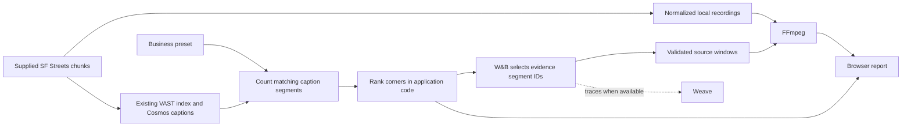

# Highlight Agent

<p align="center">
  <strong>Find your corner. See the evidence.</strong><br>
  Compare street corners for your next shop, then watch the clips behind the shortlist.
</p>

<p align="center">
  <a href="#the-jury-example-where-should-i-open-my-bike-shop">Jury example</a> ·
  <a href="#try-it-locally">Quick start</a> ·
  <a href="#3-build-the-business-report">Business report</a> ·
  <a href="#under-the-hood">Architecture</a> ·
  <a href="#prove-the-result">Evaluation</a>
</p>

Built for **Real-Time Video Agents Hack**, London · **17 October 2026**.

## The jury example: “Where should I open my bike shop?”

You are opening a bike repair shop. You have footage from five San Francisco corners. Which one should you investigate first?

Choose **Bike shop**. Highlight Agent compares captions describing people riding bicycles across all five recordings, ranks the corners, and makes short evidence reels for the leading locations. Open a clip to see its caption, exact source chunk, and offset.

**Five corners · 15 minutes of footage · 20-second evidence reels.** The saved run recorded **28.1 seconds** for all four business comparisons and their evidence reels, using footage already imported and indexed. Import and caption generation are outside that timing.


### The parked-bike trap

A search for any mention of a bicycle would put **Camera 1 first**. One of its captions describes a bicycle parked beside a bin. For this demo, we narrow the signal to captions describing **cyclists or riding**:

| Corner | Segments mentioning any bicycle | Segments matching the riding signal |
| --- | ---: | ---: |
| **Camera 3** | 13 / 36 | **11 / 36** |
| **Camera 5** | 11 / 36 | **9 / 36** |
| **Camera 1** | **25 / 36** | 1 / 36 |

Camera 3 leads on the riding signal. Its **20-second reel contains two source clips** you can inspect before deciding what to investigate next.

Each number counts **five-second caption segments**, so the same cyclist may appear in more than one segment. These are caption matches, not unique cyclist or customer counts.

### Same streets. Different businesses.

Change the business and the useful signal changes with it. These are results from the same saved report:

| You want to open… | The report looks for… | Result in this sample |
| --- | --- | --- |
| 🚲 **Bike shop** | People riding bicycles | Camera 3 leads: **11 / 36** matching segments. |
| ☕ **Café** | Groups of pedestrians | Camera 1 leads: **17 / 36**. |
| 🚌 **Transit kiosk** | Buses | Cameras 2 and 4 tie: **15 / 36** each. |
| 🐕 **Dog shop** | Dogs in the captions | **Not enough evidence to recommend a corner.** The best has only **2 / 36**. |

The report recommends a corner only when at least three segments there match the chosen signal. The dog-shop result demonstrates how it handles a thin sample.

### A 60-second jury walkthrough

1. **Ask:** “I'm opening a bike shop. Which of these five corners should I scout first?” Select **Bike shop**.
2. **Show:** Camera 3 leads. Play its 20-second evidence reel and point to the source references.
3. **Explain:** “A bicycle keyword search puts Camera 1 first. Look at this example: a parked bike. Looking for riders changes the shortlist.”
4. **Switch:** Select **Café**, then **Dog shop**. Show the changed ranking and the explicit “not enough evidence” result.

> “Tell us what you're opening. We'll show you which corner to scout first, and the clips that explain why.”

This is a scouting sample: **three minutes per corner, recorded on different dates and at different times**. It helps choose where to look next. A location decision needs longer, comparable recordings and information such as rent and competition.

**Current scope:** supplied SF Streets footage, four preset business comparisons, browser reports, and **16:9, 720p** evidence reels. The same pipeline also supports a [conversational highlight editor](#4-direct-your-own-cut). The separate [Corner Scout prototype](#free-text-corner-scout-prototype) explores free-text business requests using frame estimates.

## Try it locally

You need **Python 3.11+**, [uv](https://docs.astral.sh/uv/), and **FFmpeg**, with both `ffmpeg` and `ffprobe` on `PATH`. Run these commands from the repository root; copy `.env.example` only if you do not already have a `.env`, and fill in the provider settings below before starting the application.

```sh
uv sync --extra dev
cp .env.example .env
# Fill in .env using the provider settings below.
uv run highlight-agent doctor
uv run python app.py
```

Configure the providers below. The Gradio editor normally opens at **http://127.0.0.1:7860**; use **Browse SF Streets** and **Use dataset video** to import recordings. To reproduce the jury example, import the camera streams you want to compare and [generate the business report](#3-build-the-business-report).

## From dataset to business report

### 1. Connect the providers

The default mode is **live**. Set `HIGHLIGHT_MODE=live` and fill in your local [`.env`](.env.example); the application loads it automatically.

| Setting | What to provide |
| --- | --- |
| `VAST_BASE_URL` | Your assigned VAST deployment URL. |
| `VAST_ACCESS_TOKEN` **or** `VAST_USERNAME` + `VAST_PASSWORD` | Credentials supported by that deployment. |
| `WANDB_API_KEY` | Your W&B API key. |
| `WANDB_MODEL` | An inference model available to your account. |
| `WANDB_PROJECT` | Your Weave destination as `entity/project`. |

```sh
uv run highlight-agent doctor --remote
uv run python app.py
```

`doctor --remote` checks local tools, provider connectivity, the deployment schema, and a small inference request. A successful check still needs to be followed by a dataset import and actual retrieval/ranking.

W&B can return HTTP 401 when the key is valid but `WANDB_PROJECT` points to a workspace you cannot access. Use an `entity/project` in your own W&B workspace; your VAST workshop team assignment does not grant access to a W&B team. Restart a running application after changing `.env`.

`WANDB_INFERENCE_BASE_URL` overrides the inference endpoint. Keep `WANDB_BASE_URL` for the W&B/Weave SDK; pointing it at inference prevents trace initialization. Optional `VAST_UPLOAD_BUCKET`, `VAST_HOST_HEADER`, and `VAST_CAPTION_MODEL` settings are documented in [`.env.example`](.env.example). A configured caption model is a hint; confirm execution from returned segment model IDs and deployment evidence.

<details>
<summary><strong>Workshop connectivity: Team 37 SSH tunnel</strong></summary>

The Team 37 API is reachable from the lab VM. On a Mac, keep this tunnel running in a separate terminal, replacing `YOUR_LAB_SSH_ALIAS` with your configured lab connection:

```sh
ssh -N -T -o ExitOnForwardFailure=yes \
  -L 127.0.0.1:18737:video-lab-team-37.cosmos.vastdata.com:80 YOUR_LAB_SSH_ALIAS
```

Set `VAST_BASE_URL=http://127.0.0.1:18737` and `VAST_HOST_HEADER=video-lab-team-37.cosmos.vastdata.com` in `.env`. The host header preserves ingress routing. Restart the tunnel after closing its terminal or restarting your Mac.

This deployment serves the UI at `/openapi.json`, so schema inspection may fail even when API login and authenticated configuration reads work. Those checks alone do not establish successful dataset retrieval or rendering.

</details>

### 2. Import supplied SF Streets footage

Browse the supplied camera streams and import one using the exact source URI returned by the listing:

```sh
uv run highlight-agent datasets

# Replace SOURCE_URI with the original_video URI from the chosen camera entry.
uv run highlight-agent import-dataset SOURCE_URI
```

The importer downloads the exact original objects for up to six contiguous chunks from the selected stream. It uses the shared FFmpeg renderer to prepare each object's indexed window, from zero through `chunk_duration_sec`, as H.264 at 720p and 30 fps, then concatenates those excerpts into a browser-playable recording. The original HEVC files can extend beyond their indexed windows; import excludes those uncaptioned trailing frames. Six indexed 30-second windows provide about **180 seconds**. It reuses the supplied captions without uploading footage or creating a new index. Keep the returned video ID for custom cuts; business reports discover the imported cameras automatically.

Each remote caption interval is relative to its own chunk. The importer measures the prepared excerpts and records their cumulative starts in the assembled recording; retrieval adds the matching offset to each original interval. The source player, edit plan, and evidence windows use this continuous indexed timeline. Exact original source URIs, original durations and hashes, and prepared excerpt boundaries preserve the mapping back to the supplied dataset.

Reimporting a registered source keeps its video ID. If local media is missing or changed, the importer rebuilds the registered excerpt and checks its saved source hashes, timing, and caption coverage before replacing the media.

### 3. Build the business report

Import each camera you want to compare with `import-dataset`; the saved demo uses five. The report includes every imported SF Streets recording marked ready.

```sh
# Optional: generate camera summaries and landmark headlines first.
uv run python scripts/city_report.py

# Build all four business comparisons and their evidence reels.
uv run python scripts/business_report.py

# Serve the generated reports and videos locally.
python -m http.server 8765 --bind 127.0.0.1 --directory outputs
```

The business-report command prints `outputs/business-report/RUN/index.html`. Open **`http://localhost:8765/business-report/RUN/index.html#bike-shop`**, replacing `RUN` with the generated folder name. The `localhost` address works on the machine serving the report; share a hosted copy or a recorded walkthrough with remote judges.

The report writes:

```text
outputs/business-report/RUN/
├── index.html                 # Business tabs, rankings, evidence players
├── report.json                # Counts, source references, timing, trace link
└── bike-shop/rank-1/
    ├── reel.mp4               # Evidence reel (20-second budget by default)
    ├── edit_plan.json         # Exact source windows
    └── clip-*.jpg             # Source stills and filmstrips
```

The other business types and qualifying runner-up corners have their own evidence folders. To choose a destination or reuse headlines from a particular city report:

```sh
uv run python scripts/business_report.py \
  --city-report outputs/city-report/RUN/report.json \
  --duration 20 --output-dir outputs/business-report/my-demo
```

### 4. Direct your own cut

For a custom visual brief, use the Gradio editor or CLI:

```sh
uv run highlight-agent make VIDEO_ID --prompt 'Show me pedestrians and cyclists.' --duration 30
uv run highlight-agent make VIDEO_ID --prompt 'Show me buses and street traffic.' --duration 30

# Use the edit id returned by make, then the new id returned by revise.
uv run highlight-agent revise EDIT_ID \
  --instruction 'Remove clip two and put the highest-ranked moment first.'
uv run highlight-agent undo REVISED_EDIT_ID
```

The same workflow is available in the UI: source playback, brief cards, progress, a changing timeline, evidence previews, revision, undo, and downloads. Revisions preserve the selected source windows and keep the preceding edit available for undo.

### Free-text Corner Scout prototype

The linked business report uses existing captions and four presets. A separate prototype accepts a business description, maps it to audience weights, and ranks corners using cached vision-model estimates from one frame per segment:

```sh
uv run python scripts/vision_tags.py
uv run python scripts/corner_scout.py
# Opens on http://127.0.0.1:7861 by default.

# Or generate a ranking from the command line:
uv run python scripts/corner_scout.py --business 'bike repair shop'
```

Frame counts and audience categories are model estimates. They are separate from the caption-segment counts and measured run shown above.

Tagging reuses valid cached observations and retries failed or invalid ones. Failed observations remain gaps rather than zero counts. The [alternate prototype demo plan](docs/DEMO_PLAN.md) records earlier free-text examples; the jury walkthrough above uses the preset business report.

## Under the hood



| Tool | Contribution | Evidence to inspect in a live run |
| --- | --- | --- |
| **VAST** | Read supplied media and indexed caption segments; search them for custom briefs. | Original source URIs, chunk mapping, index status, and retrieved records. |
| **NVIDIA Cosmos** | Supply existing visual captions from the dataset's hosted ingestion. | Returned segment model IDs, confirmed against the deployment. |
| **W&B Inference** | Select evidence segment IDs for business reports; summarize cameras; translate and rank custom briefs. | Actual model calls and selected IDs. |
| **W&B Weave** | Trace provider and application calls when configured. | Trace links returned by the run, when available. |
| **FFmpeg** | Extract, normalize, and concatenate source windows; optionally mix demo narration. | Playable output and measured render timing. |
| **Gradio** | Provide the conversational editor and separate free-text Corner Scout interface. | The local applications. |

**Application code ranks the corners. The model chooses evidence clips.** The preset business report counts caption segments matching explicit patterns, orders corners by those counts, and asks W&B to choose known segment IDs from the matching candidates. Riding patterns narrow bicycle mentions to cyclist/riding language; source clips let viewers check the result.

**Application code also controls timestamps.** The shared selector adds two seconds of setup and three seconds of aftermath, clamps to the source, skips overlapping street scenes, and fits complete events into the budget. A shorter reel is valid when fewer complete matches fit.

The custom-brief editor uses VAST retrieval followed by W&B ranking. Both caption-based workflows reuse the supplied Cosmos captions. Credentials, the hosted index, and source footage are not bundled. See the [validation notes](docs/VALIDATION.md) for measured evidence and remaining checks.

## Inputs, outputs, and evidence

**Input:** supplied SF Streets camera streams, up to six contiguous source chunks per recording and their existing VAST captions. Choose a business preset for a comparison report, or a custom brief and a duration of at most 30 seconds for the editor.

**Output:** a **1280×720, 30 fps, H.264/AAC MP4** with `yuv420p` and `+faststart`. Sources without audio receive silence. Each new highlight writes:

```text
outputs/<edit_id>/
├── reel.mp4        # Playable compilation
├── edit_plan.json  # Ordered source windows and duration budget
├── result.json     # Selected moments, reasons, timings, warnings, trace link
└── evidence.json   # Search queries, retrieved candidates, reported caption model
```

All edit window timestamps are seconds relative to the assembled local recording. Each `SourceChunk` retains its exact remote `original_video` URI, original `source_duration` and `source_sha256`, plus the prepared excerpt's measured `duration` and cumulative `start_seconds`. Remote segment intervals are validated within the indexed chunk window before being shifted onto the assembled timeline. Revisions write a new reel, plan, and result linked to the previous edit; they reuse the existing selection evidence. Shared Python contracts live in [`highlight_agent/models.py`](highlight_agent/models.py), with `make_highlight(video_id, prompt, max_duration=30)` and `render_edit_plan(plan)` as the main service/rendering interfaces.

Keep `.env`, footage, local manifests, renders, and traces out of Git. `data/` and `outputs/` are ignored. Preserve related artifacts together for offline presentation.

## Prove the result

Run the local checks:

```sh
uv run ruff check .
uv run pytest -q
```

Tests cover provider contracts with mocked HTTP responses, interval selection, source integrity, persistence, revision/undo, malformed model output, CLI failures, human evaluation, and actual FFmpeg exports. The [validation notes](docs/VALIDATION.md) record local browser and rendering checks, with live checks listed separately.

For the business report, inspect `report.json`, check the segment counts against the indexed captions, and watch every evidence reel against its named source. Confirm that business tabs change the ranking, tied corners remain tied, and sparse evidence produces no recommendation. The saved example above is from `outputs/business-report/20261017-140003/report.json`; generated reports and footage remain local and are ignored by Git. The counts demonstrate the report's behavior and do not establish caption accuracy or commercial demand.

For SF Streets quality, replace the placeholder video ID and illustrative intervals in [`examples/evaluation-sf-streets.json`](examples/evaluation-sf-streets.json) with **two people-focused moments, two traffic-focused moments, and two ordinary street moments** reviewed in your imported recording. The profile is `sf-streets`, with labels `people`, `traffic`, and `ordinary`.

```sh
uv run highlight-agent evaluate examples/evaluation-sf-streets.json
```

Compare the returned captions against the original footage, fill in each case's `caption_correct`, `observed_label`, and `notes`, then rerun. The human-review gate requires:

- All six cases reviewed against available indexed evidence.
- At least five correct captions and both people and traffic examples recognized.

Unreviewed examples cannot pass. Check complete action boundaries, alignment across chunk joins, changed selections for both briefs, no duplicates, missing audio, duration budgets, and clear empty-result/provider errors. Report actual source duration, import/request/render timings, model IDs, source windows, and available trace links from genuine artifacts.

### Synthetic offline fixture

To exercise local plumbing without credentials:

```sh
HIGHLIGHT_MODE=offline_sample uv run highlight-agent doctor
HIGHLIGHT_MODE=offline_sample uv run highlight-agent sample
HIGHLIGHT_MODE=offline_sample uv run python app.py
```

The offline sample uses generated color panels and manually labeled captions. Its legacy Pro/Roast fixtures exercise selection, persistence, and real FFmpeg rendering; they provide no SF Streets or sponsor-execution evidence. The legacy evaluation template is [`examples/evaluation.json`](examples/evaluation.json). Live failures never silently switch to this sample.

## The demo uses the same renderer

Record a genuine 16:9 rehearsal, then assemble the presentation with the renderer that makes the highlights:

```sh
uv run highlight-agent demo examples/demo-plan.json --output-dir outputs/demo
uv run highlight-agent demo examples/demo-plan-extended.json --output-dir outputs/demo-final
```

First replace the illustrative scene windows with measured timestamps from `data/rehearsal.mp4`. Paths resolve relative to the manifest. An optional `narration_path` points to human narration recorded against the assembled cut. These example manifests are templates, rather than prerecorded successful runs; presentation scene selection is manual.

Lead with the **60-second business walkthrough above**. The [editor demo guide](docs/DEMO_SCRIPT.md) covers optional revision and undo, and the [recording/toolchain guide](demo-video-toolchain-setup.md) covers capture and assembly. Use fresh requests when measured latency fits the slot; label saved runs and disclose shortened waits. Claim that the demo was assembled with the tool only after rendering the real rehearsal this way.

### Hackathon handoff

The [event requirements captured in the build plan](HACK_PLAN.md#requirements-and-success-criteria) cover idea, intuitive design, technical quality, reproducibility, documented inputs/outputs and evaluation, and effective use of at least three sponsor tools. The table above identifies intended contributions; actual traces and artifacts establish which tools ran.

Before submitting by **4:30 PM BST on 17 October 2026**:

- Include every team member's name and contact email in the submission.
- Provide an accessible repository, a shareable demo video, and a build/tool description.
- Confirm recording requirements in the submission form and verify the video link without your login.
- Keep the first-round presentation to **two minutes**; prepare a **three-minute** top-five final for **6 PM BST**.

For implementation decisions, ownership, and milestones, see the [build plan](HACK_PLAN.md).
