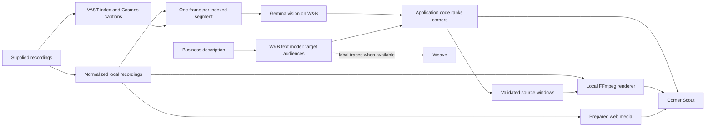
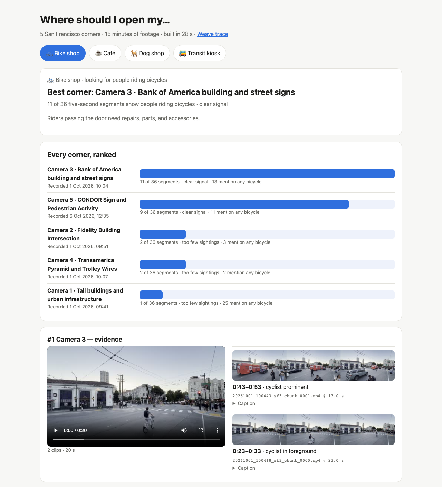

# Highlight Agent

<p align="center">
  <strong>Find your corner. See the evidence.</strong><br>
  Corner Scout turns recorded street footage into a shortlist of locations for your business, with playable evidence behind every recommendation.
</p>

<p align="center">
  <a href="https://corner-scout-rouge.vercel.app"><strong>Try the live demo</strong></a> ·
  <a href="https://corner-scout-rouge.vercel.app/explorer.html">Explore all footage</a> ·
  <a href="#watch-the-demo">Watch the video</a> ·
  <a href="#try-it-locally">Quick start</a> ·
  <a href="#prepare-footage">Prepare footage</a> ·
  <a href="#under-the-hood">How it works</a> ·
  <a href="#prove-the-result">Validation</a>
</p>

**Corner Scout** is the featured application in Highlight Agent, a toolkit for finding visual moments and rendering evidence reels. Describe a business, compare corners within one city, and inspect the footage behind the ranking. The toolkit also includes caption reports and a conversational highlight editor.

Built for **Real-Time Video Agents Hack**, London · **17 October 2026**.

<a id="watch-the-demo"></a>

## 🎬 See it in action

<p align="center">
  <a href="docs/assets/corner-scout-demo.mp4"></a><br>
  <a href="docs/assets/corner-scout-demo.mp4"><strong>Watch the 82-second demo with sound</strong></a>
</p>

The video shows real searches from the **original five-camera San Francisco sample**: dog grooming, luxury car detailing, and a kids' toy store with too little evidence for a recommendation. Each search calls the live profile endpoint; the displayed timings are measured. The presenter is AI-generated and the music is synthesized. [Recording and assembly details](#the-demo-uses-the-same-renderer).


<a id="features"></a>
<a id="corner-scout-where-should-i-open-my"></a>

## ✨ Features

| You want to… | Use… | What you get |
| --- | --- | --- |
| Find a location for a business | **Find my corner** | City-specific rankings of reviewed fixed street cameras, audience matches, and playable source evidence. |
| Search the supplied collection | **Explore all footage** | Caption keyword search, location/scene/recording filters, source intervals, and import/playable coverage. |
| Inspect a recommendation | **Evidence viewer** | Sampled frames, audience counts, and the exact source moment behind a match. |
| Make a custom reel | **Local highlight editor** | Visual briefs, source previews, revision, undo, and downloadable MP4s. |

**Complete collection:** 55 recordings · 612 chunks · 3,537 caption segments · about 4 hours 55 minutes, all searchable and playable. It spans New York, San Francisco, Toronto, neighborhood streets, indoor activity, warehouses, and Nashville traffic. Recording previews and sampled evidence images total **681.24 MB**, below the 800 MB budget. Originals remain in VAST; verified indexed footage supports local offline playback. See [collection validation](docs/VALIDATION.md#full-collection-expansion).

**Recommendations need evidence:** at least **3 core-audience samples**, **3 analyzed minutes**, and **90% valid duration coverage**. Scores use audience presence weighted by segment duration. Moving cameras, highways, and operational indoor footage remain searchable in the explorer.

**Current scouting data:** **937 valid observations across six full recordings, covering 78.05 analyzed minutes**. San Francisco uses cameras **3, 4, and 5** (397 samples, 33.05 minutes). New York uses **two separate camera-1 recordings** and camera **2** (540 samples, 45 minutes). First/middle/last frame review excluded the full SF camera-1 and camera-2 recordings because their viewpoints move; both remain in the explorer. Every eligible indexed segment has a successful vision observation.

<details>
<summary><strong>Current full-recording results: six business examples</strong></summary>

| Example | San Francisco | New York |
| --- | --- | --- |
| **Dog grooming salon** | **Camera 5** · dogs in **10/180** samples | **Not enough evidence** · best recording has dogs in **2/180** samples |
| **Luxury watch boutique** | **Camera 5** · premium cars in **86/180** | **Camera 2** · premium cars in **49/180** |
| **Student coffee shop** | **Camera 5** · young adults in **33/180** | **Camera 1 · recording 2** · young adults in **28/180** |
| **Kids' toy store** | **Camera 5** · families with children in **8/180** | **Camera 1 · recording 2** · families with children in **13/180** |
| **Bike repair shop** | **Camera 5** · cyclists in **48/180** | **Camera 1 · recording 2** · cyclists in **67/180** |
| **Souvenir shop** | **Not enough evidence** · no tourist samples | **Camera 2** · tourists in **3/180** |

Counts describe positive sampled frames at the leading recording, rather than unique customers. SF camera 3 has 37 samples, including a shortened final segment; the other eligible recordings have 180 each. Code compares duration-weighted presence only within the selected city and applies the evidence thresholds above.

These measured results use real saved business profiles and completed vision caches. The local artifact `outputs/full-example-rankings.json` records weights, scores, source intervals, hashes, and matching Python/browser results for all 12 city/example combinations. Fresh business profiles can choose different helpful audiences; named audiences stay core. The vision pass took **18 minutes 6 seconds elapsed**, including **12 minutes 20 seconds of active processing** while imports arrived.

</details>

**Keep the limits in mind.** Audience labels are vision-model estimates from sampled frames. Counts can include the same person, animal, or vehicle more than once. Recordings cover different dates, times, and durations; they help choose where to investigate next. A lease decision also needs comparable recordings, rent, and competition data. **Human caption and vision accuracy review remains pending.**

The 82-second video, screenshot, and historical tables below describe the **original 15-minute SF sample**, with three minutes per corner. Its 180 frames took 2.7 minutes to tag; saved business searches took about 2–6 seconds. The current full-recording results above differ: the kids' toy store now has enough evidence at SF camera 5.

<details>
<summary><strong>Original SF sample: camera observations and business rankings</strong></summary>

### Who passes each corner

Captions could not answer “who”: across 180 captions, none names a car brand or says “luxury”, one mentions a suit, and none mentions an older person. So a **Gemma 4 vision model on W&B Inference** looked at one frame per five-second segment and estimated what it saw: office workers, students and young adults, families with children, older adults, workers in uniform, premium, mid-range and budget cars, taxis, buses, delivery vehicles, motorcycles and scooters, cyclists, and dogs. The pass took 2.7 minutes and is cached.

| Corner | Landmark | Recorded | Seen most often (frames of 36) |
| --- | --- | --- | --- |
| Camera 1 | Downtown towers | 1 Oct, 09:41 | Premium cars 28 · delivery vehicles 24 · motorcycles & scooters 16 |
| Camera 2 | Fidelity building | 1 Oct, 09:51 | Buses 17 · delivery vehicles 15 · office workers 12 · young adults 10 |
| Camera 3 | Bank of America at Stockton | 1 Oct, 10:04 | Taxis 9 · cyclists 8 · motorcycles & scooters 8 |
| Camera 4 | Transamerica Pyramid in view | 1 Oct, 10:07 | Buses 16 · premium cars 10 · motorcycles & scooters 10 |
| Camera 5 | Condor sign | 6 Oct, 12:35 | Premium cars 20 · cyclists 13 · motorcycles & scooters 7 · dogs 3 |

No tourists and no older adults were detected at any corner.

### Same streets. Different businesses.

| You type… | Core customers | Result in this sample |
| --- | --- | --- |
| 🐕 **Dog grooming salon** | Dogs | **Camera 5**, match 80/100. Dogs in 3 of 36 frames; three other corners have none. |
| 🚗 **Luxury car detailing** | Premium cars | **Camera 1**, 85/100. Premium cars in 28 of 36 frames. |
| 📚 **Student bookshop** | Students & young adults | **Camera 2**, 92/100. Young adults in 10 of 36 frames. |
| 🚲 **Bike repair shop** | Cyclists | **Camera 5**, 83/100. Cyclists in 13 of 36 frames. |
| 🧸 **Kids' toy store** | Families with children | **Not enough evidence.** One stroller in 180 frames. |
| 🎁 **Souvenir shop** | Tourists | **Not enough evidence.** No tourists seen. |

Each result above came out the same in two runs. When a description names an audience (dog, luxury, student, kids, bike…), that audience is always core. Otherwise the text model chooses, and its choice can vary between runs; the chips on every result show what it chose. The original sample required at least three core-audience frames for a recommendation; current full recordings also need the duration and coverage checks above.

### Why frames, not just captions

At Camera 1, **25 of 36 captions mention a bicycle**. Counting caption words would call it a cycling hotspot. The frames show a parked kick scooter and no riders: the vision pass counts **0 cyclists** there. Evidence clips let anyone check.

</details>


<a id="a-2-minute-walkthrough"></a>

<details>
<summary><strong>Two-minute walkthrough for the full collection</strong></summary>

1. **Open Explore all footage** and show actual coverage. Search **forklift** in **Warehouse**, play a result, and inspect its supplied caption and exact source interval. Confirm complete coverage before claiming every recording is playable.
2. **Return to Find my corner**, select **San Francisco**, and click **Dog grooming salon**. Camera 5 leads with dogs in **10/180** samples; play the supporting footage.
3. **Switch to New York** and click **Luxury watch boutique**. Camera 2 leads with premium cars in **49/180** samples. Camera 1's two recordings stay separate.
4. **Show an abstention:** **Dog grooming salon** in New York has at most **2/180** core samples, or **Souvenir shop** in San Francisco has none. The current **Kids' toy store** example recommends SF camera 5, with families in **8/180** samples.
5. **Point at analyzed duration and coverage.** The current Scout uses six motion-reviewed recordings and 937 valid observations. Local runs can show a Weave trace when available; hosted searches do not create traces.

For the timed script, preparation steps, historical recording, and limitations, see the [demo plan](docs/DEMO_PLAN.md).

</details>


<a id="try-it-locally"></a>

## 🚀 Quick start

### Run the web demo locally

You need **Node.js 24** and a **W&B Inference API key and text model** for business searches. Run commands from the repository root.

1. If you do not already have a `.env`, create it from the template:

   ```sh
   cp .env.example .env
   ```

2. Set these values in the root `.env`:

   ```dotenv
   WANDB_API_KEY=YOUR_WANDB_API_KEY
   WANDB_MODEL=YOUR_AVAILABLE_TEXT_MODEL
   ```

   `WANDB_PROJECT` is optional for the web app. Remove the template's `your-team/highlight-agent` placeholder, or replace it with an accessible `entity/project` if your workspace requires it.

3. Start the app:

   ```sh
   npm --prefix web run dev
   ```

Open **http://localhost:3000** for Corner Scout, or **http://localhost:3000/explorer.html** for the caption explorer. The server loads the root `.env` automatically. Restart it after changing provider settings.

The web app uses prepared observations and media. Python, VAST access, and FFmpeg are needed when [preparing footage](#prepare-footage); installing npm packages is needed for [Blob publishing](#full-collection-workflow).

### Choose the local app you need

| App | Start command | Default address | Before starting |
| --- | --- | --- | --- |
| Web demo | `npm --prefix web run dev` | `http://localhost:3000` | W&B settings for live business searches. |
| Python Corner Scout | `uv run python scripts/corner_scout.py` | `http://127.0.0.1:7861` | Python setup, imported footage, camera review, and vision tags. |
| Highlight editor | `uv run python app.py` | `http://127.0.0.1:7860` | Python setup and provider settings; import footage from the UI or CLI. |

<a id="prepare-footage"></a>
<a id="from-dataset-to-corner-ranking"></a>

## 🧭 Prepare footage

Use this workflow to analyze recordings, run Python Corner Scout, or refresh the web app's exported data. The existing web demo can be started with the quick start above.

<a id="1-connect-the-providers"></a>

### 1. Set up Python and connect providers

You need **Python 3.11+**, [uv](https://docs.astral.sh/uv/), and **FFmpeg**, with both `ffmpeg` and `ffprobe` on `PATH`.

```sh
uv sync --extra dev
```

Create `.env` as shown in the quick start if it does not exist. The default mode is **live**; configure these values before importing or analyzing footage:

| Setting | What to provide |
| --- | --- |
| `HIGHLIGHT_MODE` | `live` for real provider calls. |
| `VAST_BASE_URL` | Your assigned VAST deployment URL. |
| `VAST_ACCESS_TOKEN` **or** `VAST_USERNAME` + `VAST_PASSWORD` | Credentials supported by that deployment. |
| `WANDB_API_KEY` | Your W&B API key. |
| `WANDB_MODEL` | A text inference model available to your account. |
| `WANDB_PROJECT` | Your Weave destination as `entity/project`; required by the Python live configuration. |

```sh
uv run highlight-agent doctor
uv run highlight-agent doctor --remote
```

`doctor --remote` checks tools, provider connectivity, the deployment schema, and a small inference request. Follow it with an import and actual retrieval/ranking to validate the complete workflow.

W&B can return HTTP 401 for a valid key when `WANDB_PROJECT` names a workspace you cannot access. Use your own accessible W&B workspace; a VAST workshop assignment does not grant W&B team access. Restart running apps after changing `.env`.

`WANDB_INFERENCE_BASE_URL` defaults to `https://api.inference.wandb.ai/v1`. Keep `WANDB_BASE_URL` for the W&B/Weave SDK; pointing it at inference prevents trace initialization. Optional `VAST_UPLOAD_BUCKET`, `VAST_HOST_HEADER`, and `VAST_CAPTION_MODEL` settings are explained in [`.env.example`](.env.example). Confirm caption-model execution from returned model IDs and deployment evidence.

<details>
<summary><strong>Workshop connectivity: Team 37 SSH tunnel</strong></summary>

The Team 37 API is reachable from the lab VM. On a Mac, keep this tunnel running in a separate terminal, replacing `YOUR_LAB_SSH_ALIAS` with your configured lab connection:

```sh
ssh -N -T -o ExitOnForwardFailure=yes \
  -L 127.0.0.1:18737:video-lab-team-37.cosmos.vastdata.com:80 YOUR_LAB_SSH_ALIAS
```

Set `VAST_BASE_URL=http://127.0.0.1:18737` and `VAST_HOST_HEADER=video-lab-team-37.cosmos.vastdata.com` in `.env`. The host header preserves ingress routing. Restart the tunnel after closing its terminal or restarting your Mac.

This deployment serves the UI at `/openapi.json`, so schema inspection may fail even when API login and authenticated configuration reads work. Those checks alone do not establish successful dataset retrieval or rendering.

</details>


<a id="2-import-supplied-sf-streets-footage"></a>

### 2. Import recordings

List the supplied recordings, then use the exact `original_video` URI from your chosen entry:

```sh
uv run highlight-agent datasets
uv run highlight-agent import-dataset SOURCE_URI
```

Each import prepares **one complete recording** and reuses its supplied captions. To resumably import the full collection instead:

```sh
uv run highlight-agent import-datasets --all
```

Keep the returned video ID for custom cuts. Full imports supersede matching older excerpts in the catalog while preserving their source IDs and saved edits. The original demo's six-chunk, three-minute excerpts are historical samples.

<details>
<summary><strong>Import details: source identity, timing, recovery, and storage</strong></summary>

The importer downloads exact original objects, fingerprints them, and prepares each chunk's indexed window as H.264 at 720p and 30 fps. It concatenates those windows into a browser-playable recording. Original HEVC objects can include uncaptioned trailing frames; import excludes those tails and does not upload or reindex the supplied footage.

Remote caption times are relative to each chunk. Measured excerpt durations and cumulative starts map those intervals onto the assembled recording. Original URIs, durations, hashes, and prepared boundaries preserve the path back to the dataset.

Repeating an import reuses verified checkpoints and the registered identity for the same recording. Missing or changed media is rebuilt and checked against hashes, timing, and caption coverage. Changed or missing sources never count as playable.

Bulk import keeps originals in VAST and releases downloaded original caches only after the indexed recording and captions are verified and saved locally. It retains source metadata, hashes, mappings, failures, and coverage; interrupted recordings keep their download checkpoints. Use `uv run highlight-agent import-datasets --all --keep-originals` to retain downloaded originals when disk space allows.

</details>


<a id="3-run-corner-scout"></a>

### 3. Review cameras, tag frames, and run Scout

Full recordings need a **fixed-camera review before audience tagging**. Extract the first, middle, and last views:

```sh
uv run python scripts/vision_tags.py --review-samples
```

Inspect the generated images, then record each camera decision in `data/catalog/scouting-review.json`. Replace the placeholders with the recording's stream ID and registered content hash; merge entries if the file already exists:

```json
{
  "STREAM_ID": {
    "eligible": true,
    "note": "First, middle, and last views show the same fixed street corner.",
    "source_sha256": "THE_REGISTERED_CONTENT_HASH"
  }
}
```

Only mark eligible recordings after inspection. Previously reviewed legacy SF sample excerpts keep their eligibility until superseded. Then analyze the eligible recordings and launch Scout:

```sh
uv run python scripts/vision_tags.py
uv run python scripts/corner_scout.py
```

Open **http://127.0.0.1:7861**, type a business, or choose an example. Scout defaults to San Francisco. To choose another city or get a JSON ranking and rendered reels from the CLI:

```sh
uv run python scripts/corner_scout.py --city 'New York'
uv run python scripts/corner_scout.py --business 'dog grooming salon'
```

`vision_tags.py` also accepts `--city 'New York'`. It sends each indexed segment's midpoint frame to `google/gemma-4-31B-it` on W&B Inference and saves category estimates in `data/vision/<video_id>.json`. Valid observations are cached; failed or invalid ones are retried and remain coverage gaps until successful.

For each business, the configured text model chooses one or two **core** audiences and up to three **helpful** ones. Application code ranks the corners and writes available evidence reels for the leading corners into `outputs/corner-scout/<time>-<business>/rank-N/`, including their `edit_plan.json`. Sparse evidence can produce fewer reels or none. Optional landmark headlines and per-camera reels come from `uv run python scripts/city_report.py`.

### 4. Refresh the local web data

Export recording previews before scouting observations:

```sh
uv run python scripts/export_collection.py
uv run python scripts/export_vercel.py
npm --prefix web run dev
```

The dev server automatically uses generated local manifests and recording previews. They are excluded from Git and Vercel uploads. See [deployment](#host-on-vercel) to publish the collection.

<a id="host-on-vercel"></a>

## ☁️ Deployment

In Vercel, set **project root** to [web](web/), **framework** to **Other**, and **output directory** to `public`. [`web/vercel.json`](web/vercel.json) supplies the build and function settings; the project uses **Node.js 24**.

Set `WANDB_API_KEY` and `WANDB_MODEL` in Vercel's environment variables. Add an accessible `WANDB_PROJECT` if required by your workspace. `WANDB_INFERENCE_BASE_URL` is optional. Configure Preview separately if you use preview deployments; API keys stay on the server.

With the [Vercel CLI](https://vercel.com/docs/cli) installed, run from `web/`:

```sh
vercel link
vercel env add WANDB_API_KEY production
vercel env add WANDB_MODEL production
vercel --prod
```

The hosted app calls W&B Inference through `/api/profile` for each business search, then scores cached observations in the browser. VAST imports, vision analysis, and FFmpeg rendering happen locally. Hosted searches play prepared evidence and do not create Weave traces.

<a id="full-collection-workflow"></a>

<details>
<summary><strong>Publish the full collection with Vercel Blob</strong></summary>

Complete the [footage preparation](#prepare-footage) workflow first. Connect a **public Vercel Blob store** to the project and keep `BLOB_READ_WRITE_TOKEN` in your local environment or ignored `web/.env.local`.

From the repository root, install the local publishing SDK and upload collection media before scouting observations and sampled stills:

```sh
npm --prefix web ci
uv run python scripts/export_collection.py --upload
uv run python scripts/export_vercel.py --upload
```

The exporters reuse content-addressed assets, check existing objects and storage budgets, and replace hosted manifests only after referenced assets are available. Recording previews and sampled stills together must remain below **800 MB**. Credentials and full original recordings stay outside the website bundle; the explorer's hosted manifests reference Blob URLs.

Open `/explorer.html` to search captions and inspect source intervals, filters, and actual playable coverage. Partial preparation remains visible in the catalog.

</details>


<a id="original-sample-deployment"></a>

<details>
<summary><strong>Original five-camera snapshot: deployment and refresh</strong></summary>

The original snapshot used **180 vision observations across five corners**, individual five-second 480p H.264 evidence clips, and JPEG source previews. Its 82-second video and screenshot remain historical presentation assets.

Full-recording Scout exports prune superseded individual clips from `web/public/`; the original five-second clip bundle is no longer retained there. The original sample's source IDs, local footage, vision caches, and saved edits remain available locally. Current exports use the selected full recordings and the [collection publishing workflow](#full-collection-workflow). Importing footage, retagging, Gradio editing, and rendering still run locally.

</details>


<a id="under-the-hood"></a>

## 🛠️ Architecture



**Models estimate and describe; application code scores and selects.** Each corner's score uses duration-weighted audience presence, relative to other corners in the same city. Core audiences contribute 75% when helpful audiences exist, or the full score otherwise. Ordinary adults and mid-range cars are excluded as general signals. Recommendations must also pass the sample, duration, and coverage thresholds described [above](#features).

Custom briefs use VAST retrieval followed by W&B ranking. The shared selector controls timestamps: it adds two seconds of setup and three seconds of aftermath, clamps windows to the source, skips overlapping street scenes, and fits complete events into the duration budget. A shorter reel is valid when fewer complete matches fit. Caption reports count explicit patterns and ask the model to choose known segment IDs as evidence.

<a id="tools-used"></a>

### Tools and integration evidence

All four core integrations appear in the build: **VAST, NVIDIA Cosmos, W&B Inference, and W&B Weave**, from three sponsor providers.

| Integration | Contribution | Saved evidence |
| --- | --- | --- |
| **VAST** | Discover/download recordings, read indexed captions, and retrieve moments for custom briefs. | Original SF validation imported six chunks and 36 caption segments with source URIs and timestamp mappings. [Validation](docs/VALIDATION.md#current-sf-streets-workflow) · [Adapter](highlight_agent/vast.py) |
| **NVIDIA Cosmos** | Supply precomputed visual captions for the explorer, reports, and editor. | Returned rows identify `nvidia/cosmos3-nano-reasoner`. This reuses organizer-generated output; the project did not generate new Cosmos captions or reindex the footage. [Validation](docs/VALIDATION.md#current-sf-streets-workflow) |
| **W&B Inference** | Estimate frame audiences with `google/gemma-4-31B-it`; profile businesses, summarize cameras, and rank editor candidates with a text model. | Current scouting: 937 valid Gemma observations across six reviewed full recordings. The original sample retains 180 historical observations. Live text checks used `meta-llama/Llama-3.3-70B-Instruct`. [Vision pass](scripts/vision_tags.py) · [Text client](highlight_agent/inference.py) |
| **W&B Weave** | Trace local provider and application calls when configured. | A real trace was flushed and read back; live people/traffic edits saved trace URLs. [Connection validation](docs/VALIDATION.md#verified-live-connections) · [Tracer](highlight_agent/tracing.py) |

**Supporting tools:** FFmpeg/ffprobe prepare and inspect media; Gradio supplies the Python apps; Python/uv run the pipeline; Node.js/Vercel serve the web app. The Python stack uses the OpenAI-compatible SDK, HTTPX, Pydantic, and python-dotenv. Pytest, Ruff, and Playwright support validation/capture; Vercel Blob is optional for publishing. See [Python dependencies](pyproject.toml) and the [web package](web/package.json).

Saved execution artifacts remain local in `outputs/validation/` (`live-connection-check.json`, `sf-import.json`, `sf-people.json`, and `sf-traffic.json`) and `data/vision/*.json`. They establish tool use; [validation notes](docs/VALIDATION.md) summarize the results and remaining checks.

<a id="inputs-outputs-and-evidence"></a>

<details>
<summary><strong>Inputs, outputs, and source mapping</strong></summary>

**Input:** complete supplied recordings and their existing VAST captions. Corner Scout compares reviewed fixed street cameras within one city. Preset reports use caption signals; the editor accepts a custom brief and a duration of at most 30 seconds.

**Local renderer output:** a **1280×720, 30 fps, H.264/AAC MP4** with `yuv420p` and `+faststart`. Sources without audio receive silence. The hosted app plays prepared clips or seeks within exported recording previews. It does not render a new compilation. Each new local highlight writes:

```text
outputs/<edit_id>/
├── reel.mp4        # Playable compilation
├── edit_plan.json  # Ordered source windows and duration budget
├── result.json     # Selected moments, reasons, timings, warnings, trace link
└── evidence.json   # Search queries, retrieved candidates, reported caption model
```

All edit window timestamps are seconds relative to the assembled local recording. Each `SourceChunk` retains its exact remote `original_video` URI, original `source_duration` and `source_sha256`, plus the prepared excerpt's measured `duration` and cumulative `start_seconds`. Remote segment intervals are validated within the indexed chunk window before being shifted onto the assembled timeline. Revisions write a new reel, plan, and result linked to the previous edit; they reuse the existing selection evidence. Shared Python contracts live in [`highlight_agent/models.py`](highlight_agent/models.py), with `make_highlight(video_id, prompt, max_duration=30)` and `render_edit_plan(plan)` as the main service/rendering interfaces.

Keep `.env`, full source recordings, local manifests, renders, and traces out of Git. `data/` and `outputs/` are ignored. The website contains public manifests, UI assets, and selected preview images; generated full-recording media is published through Vercel Blob. Preserve related local artifacts together for offline presentation.

</details>


<a id="prove-the-result"></a>

## 🧪 Validation

Run the automated checks from the repository root:

```sh
uv run ruff check .
uv run pytest -q
npm --prefix web test
```

Python checks need the [development setup](#1-connect-the-providers). Tests cover provider contracts, selection, source integrity, persistence, revision/undo, malformed model output, CLI failures, human evaluation, and real FFmpeg exports. Web tests cover the hosted workflows. [Validation notes](docs/VALIDATION.md) distinguish automated checks, saved-run playback, and live-provider evidence.

**Status: pending human review.** Automated checks do not establish caption accuracy, vision accuracy, unique customer counts, or commercial demand. Inspect the named source footage before reporting reviewed agreement counts.

<details>
<summary><strong>Manual evaluation: vision frames, captions, and source alignment</strong></summary>

For Corner Scout, spot-check the vision estimates behind each core audience used in the demo. List the frames where an audience was counted, extract them, and confirm by eye:

```sh
uv run python -c "import json; d=json.load(open('data/vision/VIDEO_ID.json')); print([f['seconds'] for f in d['frames'] if f.get('counts') and f['counts'].get('dog')])"
ffmpeg -loglevel error -ss SECONDS -i data/media/VIDEO_ID.mp4 -frames:v 1 check.jpg
```

Select current source IDs and positive evidence intervals from `outputs/full-example-rankings.json`; include negative frames when checking the audience estimates. The original sample's planned 13-frame check (three dog frames, five premium-car frames, five young-adult frames) belongs to the historical 15-minute demo. **Status: pending human review.** Report only the reviewed agreement count. The motion review of all eight candidate recordings is complete; it does not validate the audience labels. Rerun saved rankings after changing the vision cache or scoring code.

For the [preset business report](#4-preset-business-report-caption-based), inspect `report.json`, check the segment counts against the indexed captions, and watch every evidence reel against its named source. Confirm that business tabs change the ranking, tied corners remain tied, and sparse evidence produces no recommendation. The saved example is from `outputs/business-report/20261017-140003/report.json`; generated reports and footage remain local and are ignored by Git. The counts demonstrate the report's behavior and do not establish caption accuracy or commercial demand.

For SF Streets quality, replace the placeholder video ID and illustrative intervals in [`examples/evaluation-sf-streets.json`](examples/evaluation-sf-streets.json) with **two people-focused moments, two traffic-focused moments, and two ordinary street moments** reviewed in your imported recording. The profile is `sf-streets`, with labels `people`, `traffic`, and `ordinary`.

```sh
uv run highlight-agent evaluate examples/evaluation-sf-streets.json
```

Compare the returned captions against the original footage, fill in each case's `caption_correct`, `observed_label`, and `notes`, then rerun. The human-review gate requires:

- All six cases reviewed against available indexed evidence.
- At least five correct captions and both people and traffic examples recognized.

Unreviewed examples cannot pass. Check complete action boundaries, alignment across chunk joins, changed selections for both briefs, no duplicates, missing audio, duration budgets, and clear empty-result/provider errors. Report actual source duration, import/request/render timings, model IDs, source windows, and available trace links from genuine artifacts.

</details>


<a id="additional-workflows"></a>

## 📚 Additional workflows

These workflows share the same source references and renderer. Expand the one you need, or use the [demo plan](docs/DEMO_PLAN.md), [editor walkthrough](docs/DEMO_SCRIPT.md), and [evidence viewer guide](docs/PROOF_REVEAL.md).

<a id="4-preset-business-report-caption-based"></a>

<details>
<summary><strong>Preset business reports from captions</strong></summary>

Before the vision pass, the first version compared corners for four preset businesses using the supplied Cosmos captions alone. This legacy workflow requires retained original `sf-streets` sample records; it does not read new `hackathon-public` full imports. With those sample records available, it produces a shareable browser page:

```sh
uv run python scripts/business_report.py

# Serve the generated reports and videos locally.
uv run python -m http.server 8765 --bind 127.0.0.1 --directory outputs
```

The command prints `outputs/business-report/RUN/index.html`. Open **`http://localhost:8765/business-report/RUN/index.html#bike-shop`**, replacing `RUN` with the generated folder name. The saved run recorded **28.1 seconds** for all four comparisons and their evidence reels, using footage already imported and indexed.



| You want to open… | The report looks for… | Result in this sample |
| --- | --- | --- |
| 🚲 **Bike shop** | Captions describing people riding bicycles | Camera 3 leads: **11 / 36** matching segments. |
| ☕ **Café** | Groups of pedestrians | Camera 1 leads: **17 / 36**. |
| 🚌 **Transit kiosk** | Buses | Cameras 2 and 4 tie: **15 / 36** each. |
| 🐕 **Dog shop** | Dogs in the captions | **Not enough evidence to recommend a corner.** The best has only **2 / 36**. |

**The parked-bike trap.** A search for any mention of a bicycle would put Camera 1 first; most of those captions describe something parked by a bin. The report narrows the signal to cyclist or riding language:

| Corner | Segments mentioning any bicycle | Segments matching the riding signal |
| --- | ---: | ---: |
| **Camera 3** | 13 / 36 | **11 / 36** |
| **Camera 5** | 11 / 36 | **9 / 36** |
| **Camera 1** | **25 / 36** | 1 / 36 |

Each number counts five-second caption segments, so the same cyclist may appear in more than one segment. The vision pass later identified Camera 1's parked object as a kick scooter, which is why Corner Scout counts zero cyclists there.

The report writes:

```text
outputs/business-report/RUN/
├── index.html                 # Business tabs, rankings, evidence players
├── report.json                # Counts, source references, timing, trace link
└── bike-shop/rank-1/
    ├── reel.mp4               # Evidence reel (20-second budget by default)
    ├── edit_plan.json         # Exact source windows
    └── clip-*.jpg             # Source stills and filmstrips
```

To choose a destination or reuse headlines from a particular city report:

```sh
uv run python scripts/business_report.py \
  --city-report outputs/city-report/RUN/report.json \
  --duration 20 --output-dir outputs/business-report/my-demo
```

</details>


<a id="city-report"></a>

<details>
<summary><strong>City reports and landmark summaries</strong></summary>

Generate landmark headlines, caption summaries, activity tables computed by code, a reel per reviewed eligible camera, and a best-moment-from-every-camera reel:

```sh
uv run python scripts/city_report.py
```

The command writes `outputs/city-report/RUN/index.html`. The original SF sample's saved run took about 40 seconds; other collection sizes and provider calls can take longer.

</details>


<a id="5-direct-your-own-cut"></a>

<details>
<summary><strong>Direct your own cut: editor, revision, and undo</strong></summary>

After [Python/provider setup](#1-connect-the-providers), launch the Gradio editor:

```sh
uv run python app.py
```

Open **http://127.0.0.1:7860**. Use **Browse SF Streets** and **Use dataset video** to import footage, or import from the CLI. The picker retains the existing SF Streets labels.

For a custom visual brief, use the Gradio editor or CLI:

```sh
uv run highlight-agent make VIDEO_ID --prompt 'Show me pedestrians and cyclists.' --duration 30
uv run highlight-agent make VIDEO_ID --prompt 'Show me buses and street traffic.' --duration 30

# Use the edit id returned by make, then the new id returned by revise.
uv run highlight-agent revise EDIT_ID \
  --instruction 'Remove clip two and put the highest-ranked moment first.'
uv run highlight-agent undo REVISED_EDIT_ID
```

The same workflow is available in the UI: source playback, brief cards, progress, a changing timeline, evidence previews, revision, undo, and downloads. Revisions preserve the selected source windows and keep the preceding edit available for undo.

</details>


<a id="synthetic-offline-fixture"></a>

<details>
<summary><strong>Synthetic offline fixture: run without credentials</strong></summary>

To exercise local plumbing without credentials:

```sh
HIGHLIGHT_MODE=offline_sample uv run highlight-agent doctor
HIGHLIGHT_MODE=offline_sample uv run highlight-agent sample
HIGHLIGHT_MODE=offline_sample uv run python app.py
```

The offline sample uses generated color panels and manually labeled captions. Its legacy Pro/Roast fixtures exercise selection, persistence, and real FFmpeg rendering; they provide no SF Streets or sponsor-execution evidence. The legacy evaluation template is [`examples/evaluation.json`](examples/evaluation.json). Live failures never silently switch to this sample.

</details>


<a id="the-demo-uses-the-same-renderer"></a>

<details>
<summary><strong>Demo production: capture and assemble with the shared renderer</strong></summary>

The [demo video](#watch-the-demo) was recorded from the real web app and assembled with the renderer that makes the highlights:

```sh
npm --prefix web run dev                 # Run in a separate terminal; keep it open.
uv run python scripts/record_demo.py      # real searches → data/rehearsal.mp4 + measured beats
uv run highlight-agent demo examples/demo-plan.json --output-dir outputs/demo
```

`record_demo.py` drives the app in headless Chromium and captures every painted frame. Each search calls the live `/api/profile` endpoint, so on-screen timings are real. Captions, the pointer, and title cards are in-browser overlays, because the minimal FFmpeg build has no `drawtext`. The script writes each beat's measured start and end to `data/rehearsal.json`. [`examples/demo-plan.json`](examples/demo-plan.json) holds those measured windows from the recorded take. This capture workflow needs the Python development dependencies and Chromium. Pass `--chromium PATH` if Playwright's bundled browser is missing.

For the published cut, the presenter used a **Nano Banana Pro portrait** and **Veo 3.1 voice and lip-sync**. She was composited into four 8-second slots on the rehearsal. Her lines plus a synthesized, ducked music bed went in as `narration_path`, so `highlight-agent demo` mixed and assembled the final MP4. Paths resolve relative to the manifest. [`examples/demo-plan-extended.json`](examples/demo-plan-extended.json) is still a template for the three-minute final.

Lead with the [Corner Scout walkthrough](#a-2-minute-walkthrough); the [demo plan](docs/DEMO_PLAN.md) has the full script. The [editor demo guide](docs/DEMO_SCRIPT.md) covers optional revision and undo, and the [recording/toolchain guide](demo-video-toolchain-setup.md) covers capture and assembly. Use fresh requests when measured latency fits the slot; label saved runs and disclose shortened waits. Claim that the demo was assembled with the tool only after rendering the real rehearsal this way.

</details>


<a id="hackathon-handoff"></a>

<details>
<summary><strong>Hackathon handoff and submission checklist</strong></summary>

The [event requirements captured in the build plan](HACK_PLAN.md#requirements-and-success-criteria) cover idea, intuitive design, technical quality, reproducibility, documented inputs/outputs and evaluation, and effective use of at least three sponsor tools. The [tools used](#tools-used) section records each integration's contribution and the saved evidence behind it.

Before submitting by **4:30 PM BST on 17 October 2026**:

- Include every team member's name and contact email in the submission.
- Provide an accessible repository, a shareable demo video, and a build/tool description.
- Confirm recording requirements in the submission form and verify the video link without your login.
- Keep the first-round presentation to **two minutes**; prepare a **three-minute** top-five final for **6 PM BST**.

For implementation decisions, ownership, and milestones, see the [build plan](HACK_PLAN.md).

</details>
