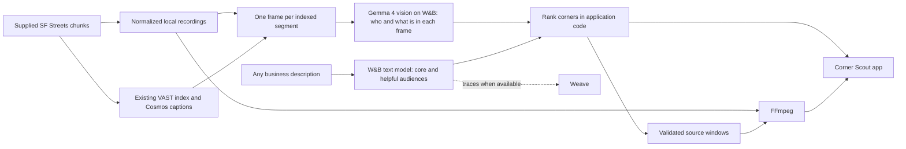

# Highlight Agent

<p align="center">
  <strong>Find your corner. See the evidence.</strong><br>
  Type any business. Corner Scout watches street footage, sees who actually passes each corner, and ranks them with video evidence.
</p>

<p align="center">
  <a href="#corner-scout-where-should-i-open-my">Corner Scout</a> ·
  <a href="#try-it-locally">Quick start</a> ·
  <a href="#3-run-corner-scout">Run it</a> ·
  <a href="#4-preset-business-report-caption-based">Preset reports</a> ·
  <a href="#under-the-hood">Architecture</a> ·
  <a href="#prove-the-result">Evaluation</a>
</p>

Built for **Real-Time Video Agents Hack**, London · **17 October 2026**.

## Corner Scout: “Where should I open my…?”

Opening a shop is a bet on one corner. Foot-traffic data tells you how many people pass, not who they are. Corner Scout looks at the street footage itself.

Type any business: *dog grooming salon*, *luxury car detailing*, *student bookshop*. Corner Scout works out who its customers are, checks five San Francisco corners for those people, cars, and animals, and ranks the corners. Every recommendation comes with an evidence reel and the exact source chunk behind each clip.

**Five corners · 15 minutes of footage · 180 frames read by a vision model · an answer in about 2–6 seconds.**


### Who passes each corner

Captions could not answer “who”: across 180 captions, none names a car brand or says “luxury”, one mentions a suit, and none mentions an older person. So a **Gemma 4 vision model on W&B Inference** looked at one frame per five-second segment and estimated what it saw: office workers, students and young adults, families with children, older adults, workers in uniform, premium, mid-range and budget cars, taxis, buses, delivery vehicles, motorcycles and scooters, cyclists, and dogs. The pass took 2.7 minutes and is cached.

| Corner | Landmark | Recorded | Seen most often (frames of 36) |
| --- | --- | --- | --- |
| Camera 1 | Downtown towers | 1 Oct, 09:41 | Premium cars 28 · delivery vehicles 24 · motorcycles & scooters 16 |
| Camera 2 | Fidelity building | 1 Oct, 09:51 | Buses 17 · delivery vehicles 15 · office workers 12 · young adults 10 |
| Camera 3 | Bank of America at Stockton | 1 Oct, 10:04 | Taxis 9 · cyclists 8 · motorcycles & scooters 8 |
| Camera 4 | Transamerica Pyramid in view | 1 Oct, 10:07 | Buses 16 · premium cars 10 · motorcycles & scooters 10 |
| Camera 5 | Condor sign | 6 Oct, 12:35 | Premium cars 20 · cyclists 13 · motorcycles & scooters 7 · dogs 3 |

No tourists and no older adults were detected at any corner.

### Same streets. Different businesses.

| You type… | Core customers | Result in this sample |
| --- | --- | --- |
| 🐕 **Dog grooming salon** | Dogs | **Camera 5**, match 80/100. Dogs in 3 of 36 frames; three other corners have none. |
| 🚗 **Luxury car detailing** | Premium cars | **Camera 1**, 85/100. Premium cars in 28 of 36 frames. |
| 📚 **Student bookshop** | Students & young adults | **Camera 2**, 92/100. Young adults in 10 of 36 frames. |
| 🚲 **Bike repair shop** | Cyclists | **Camera 5**, 83/100. Cyclists in 13 of 36 frames. |
| 🧸 **Kids' toy store** | Families with children | **Not enough evidence.** One stroller in 180 frames. |
| 🎁 **Souvenir shop** | Tourists | **Not enough evidence.** No tourists seen. |

Each result above came out the same in two runs. When a description names an audience (dog, luxury, student, kids, bike…), that audience is always core. Otherwise the text model chooses, and its choice can vary between runs; the chips on every result show what it chose. Corner Scout recommends a corner only when the best one shows its core audience in at least three sampled frames.

### Why frames, not just captions

At Camera 1, **25 of 36 captions mention a bicycle**. Counting caption words would call it a cycling hotspot. The frames show a parked kick scooter and no riders: the vision pass counts **0 cyclists** there. Evidence clips let anyone check.

### A 2-minute walkthrough

1. **Click** **Dog grooming salon**. Camera 5 wins; point at “Dogs · core” and “Dogs in 3/36 frames”, then play the evidence reel.
2. **Type** **Luxury car detailing**. Camera 1 wins on premium cars: same footage, different corner.
3. **Click** **Kids' toy store**. “Not enough evidence”: it refuses to guess.
4. **Open** the Weave trace on the result.

> “Tell us what you're opening. We'll show you who walks past each corner, and the clips that prove it.”

The full script, what to say about limits, and prep steps are in the [demo plan](docs/DEMO_PLAN.md).

**Limits.** This is a scouting sample: **three minutes per corner, recorded on different dates and at different times of day**. Premium-car and people-type calls are the vision model's judgement from single frames, and scores count frames where an audience appears, not unique people. It helps choose where to look next; a lease decision needs longer, comparable recordings plus rent and competition.

**Also in this repo:** a caption-based [preset business report](#4-preset-business-report-caption-based) for four business types, a [city report](#city-report) summarizing every camera, and a [conversational highlight editor](#5-direct-your-own-cut), all on the same footage, renderer, and source references.

## Try it locally

You need **Python 3.11+**, [uv](https://docs.astral.sh/uv/), and **FFmpeg**, with both `ffmpeg` and `ffprobe` on `PATH`. Run these commands from the repository root; copy `.env.example` only if you do not already have a `.env`, and fill in the provider settings below before starting the application.

```sh
uv sync --extra dev
cp .env.example .env
# Fill in .env using the provider settings below.
uv run highlight-agent doctor
uv run python app.py
```

Configure the providers below. The Gradio editor normally opens at **http://127.0.0.1:7860**; use **Browse SF Streets** and **Use dataset video** to import recordings. To reproduce Corner Scout, import the camera streams you want to compare, then [tag their frames and start the app](#3-run-corner-scout).

## From dataset to corner ranking

### 1. Connect the providers

The default mode is **live**. Set `HIGHLIGHT_MODE=live` and fill in your local [`.env`](.env.example); the application loads it automatically.

| Setting | What to provide |
| --- | --- |
| `VAST_BASE_URL` | Your assigned VAST deployment URL. |
| `VAST_ACCESS_TOKEN` **or** `VAST_USERNAME` + `VAST_PASSWORD` | Credentials supported by that deployment. |
| `WANDB_API_KEY` | Your W&B API key. |
| `WANDB_MODEL` | An inference model available to your account. |
| `WANDB_PROJECT` | Your Weave destination as `entity/project`. |

```sh
uv run highlight-agent doctor --remote
uv run python app.py
```

`doctor --remote` checks local tools, provider connectivity, the deployment schema, and a small inference request. A successful check still needs to be followed by a dataset import and actual retrieval/ranking.

W&B can return HTTP 401 when the key is valid but `WANDB_PROJECT` points to a workspace you cannot access. Use an `entity/project` in your own W&B workspace; your VAST workshop team assignment does not grant access to a W&B team. Restart a running application after changing `.env`.

`WANDB_INFERENCE_BASE_URL` overrides the inference endpoint. Keep `WANDB_BASE_URL` for the W&B/Weave SDK; pointing it at inference prevents trace initialization. Optional `VAST_UPLOAD_BUCKET`, `VAST_HOST_HEADER`, and `VAST_CAPTION_MODEL` settings are documented in [`.env.example`](.env.example). A configured caption model is a hint; confirm execution from returned segment model IDs and deployment evidence.

<details>
<summary><strong>Workshop connectivity: Team 37 SSH tunnel</strong></summary>

The Team 37 API is reachable from the lab VM. On a Mac, keep this tunnel running in a separate terminal, replacing `YOUR_LAB_SSH_ALIAS` with your configured lab connection:

```sh
ssh -N -T -o ExitOnForwardFailure=yes \
  -L 127.0.0.1:18737:video-lab-team-37.cosmos.vastdata.com:80 YOUR_LAB_SSH_ALIAS
```

Set `VAST_BASE_URL=http://127.0.0.1:18737` and `VAST_HOST_HEADER=video-lab-team-37.cosmos.vastdata.com` in `.env`. The host header preserves ingress routing. Restart the tunnel after closing its terminal or restarting your Mac.

This deployment serves the UI at `/openapi.json`, so schema inspection may fail even when API login and authenticated configuration reads work. Those checks alone do not establish successful dataset retrieval or rendering.

</details>

### 2. Import supplied SF Streets footage

Browse the supplied camera streams and import one using the exact source URI returned by the listing:

```sh
uv run highlight-agent datasets

# Replace SOURCE_URI with the original_video URI from the chosen camera entry.
uv run highlight-agent import-dataset SOURCE_URI
```

The importer downloads the exact original objects for up to six contiguous chunks from the selected stream. It uses the shared FFmpeg renderer to prepare each object's indexed window, from zero through `chunk_duration_sec`, as H.264 at 720p and 30 fps, then concatenates those excerpts into a browser-playable recording. The original HEVC files can extend beyond their indexed windows; import excludes those uncaptioned trailing frames. Six indexed 30-second windows provide about **180 seconds**. It reuses the supplied captions without uploading footage or creating a new index. Keep the returned video ID for custom cuts; business reports discover the imported cameras automatically.

Each remote caption interval is relative to its own chunk. The importer measures the prepared excerpts and records their cumulative starts in the assembled recording; retrieval adds the matching offset to each original interval. The source player, edit plan, and evidence windows use this continuous indexed timeline. Exact original source URIs, original durations and hashes, and prepared excerpt boundaries preserve the mapping back to the supplied dataset.

Reimporting a registered source keeps its video ID. If local media is missing or changed, the importer rebuilds the registered excerpt and checks its saved source hashes, timing, and caption coverage before replacing the media.

### 3. Run Corner Scout

Import each camera you want to compare with `import-dataset`; the saved demo uses five. Corner Scout includes every imported SF Streets recording that has vision tags.

```sh
# Once per imported footage: one frame per indexed segment to the vision model.
uv run python scripts/vision_tags.py

# Optional: landmark headlines for each corner (also builds the city report).
uv run python scripts/city_report.py

# The app: type any business, or click an example.
uv run python scripts/corner_scout.py
# Opens on http://127.0.0.1:7861 by default.

# Or rank one business from the command line (prints JSON, renders reels):
uv run python scripts/corner_scout.py --business 'dog grooming salon'
```

`vision_tags.py` sends each segment's middle frame to `google/gemma-4-31B-it` on W&B Inference and caches estimated counts per category in `data/vision/<video_id>.json` (180 frames took 2.7 minutes). It reuses valid cached observations and retries failed or invalid ones; failed observations stay gaps rather than zero counts.

For each business, the configured W&B text model (`meta-llama/Llama-3.3-70B-Instruct` in the saved runs) returns one or two **core** audiences and up to three **helpful** ones from the fixed category list. Application code then scores each corner from the cached counts, cuts evidence reels for the top two corners with the shared renderer, and writes them to `outputs/corner-scout/<time>-<business>/rank-N/` with their `edit_plan.json`.

### 4. Preset business report (caption-based)

Before the vision pass, the first version compared corners for four preset businesses using the supplied Cosmos captions alone. It still runs and produces a shareable browser page:

```sh
uv run python scripts/business_report.py

# Serve the generated reports and videos locally.
python -m http.server 8765 --bind 127.0.0.1 --directory outputs
```

The command prints `outputs/business-report/RUN/index.html`. Open **`http://localhost:8765/business-report/RUN/index.html#bike-shop`**, replacing `RUN` with the generated folder name. The saved run recorded **28.1 seconds** for all four comparisons and their evidence reels, using footage already imported and indexed.


| You want to open… | The report looks for… | Result in this sample |
| --- | --- | --- |
| 🚲 **Bike shop** | Captions describing people riding bicycles | Camera 3 leads: **11 / 36** matching segments. |
| ☕ **Café** | Groups of pedestrians | Camera 1 leads: **17 / 36**. |
| 🚌 **Transit kiosk** | Buses | Cameras 2 and 4 tie: **15 / 36** each. |
| 🐕 **Dog shop** | Dogs in the captions | **Not enough evidence to recommend a corner.** The best has only **2 / 36**. |

**The parked-bike trap.** A search for any mention of a bicycle would put Camera 1 first; most of those captions describe something parked by a bin. The report narrows the signal to cyclist or riding language:

| Corner | Segments mentioning any bicycle | Segments matching the riding signal |
| --- | ---: | ---: |
| **Camera 3** | 13 / 36 | **11 / 36** |
| **Camera 5** | 11 / 36 | **9 / 36** |
| **Camera 1** | **25 / 36** | 1 / 36 |

Each number counts five-second caption segments, so the same cyclist may appear in more than one segment. The vision pass later identified Camera 1's parked object as a kick scooter, which is why Corner Scout counts zero cyclists there.

The report writes:

```text
outputs/business-report/RUN/
├── index.html                 # Business tabs, rankings, evidence players
├── report.json                # Counts, source references, timing, trace link
└── bike-shop/rank-1/
    ├── reel.mp4               # Evidence reel (20-second budget by default)
    ├── edit_plan.json         # Exact source windows
    └── clip-*.jpg             # Source stills and filmstrips
```

To choose a destination or reuse headlines from a particular city report:

```sh
uv run python scripts/business_report.py \
  --city-report outputs/city-report/RUN/report.json \
  --duration 20 --output-dir outputs/business-report/my-demo
```

#### City report

`uv run python scripts/city_report.py` summarizes every imported camera from its captions in about 40 seconds: a landmark headline, a short summary, an activity table computed by code, a reel per camera, and a best-moment-from-every-camera reel. It writes `outputs/city-report/RUN/index.html`.

### 5. Direct your own cut

For a custom visual brief, use the Gradio editor or CLI:

```sh
uv run highlight-agent make VIDEO_ID --prompt 'Show me pedestrians and cyclists.' --duration 30
uv run highlight-agent make VIDEO_ID --prompt 'Show me buses and street traffic.' --duration 30

# Use the edit id returned by make, then the new id returned by revise.
uv run highlight-agent revise EDIT_ID \
  --instruction 'Remove clip two and put the highest-ranked moment first.'
uv run highlight-agent undo REVISED_EDIT_ID
```

The same workflow is available in the UI: source playback, brief cards, progress, a changing timeline, evidence previews, revision, undo, and downloads. Revisions preserve the selected source windows and keep the preceding edit available for undo.

## Under the hood



| Tool | Contribution | Evidence to inspect in a live run |
| --- | --- | --- |
| **VAST** | Read supplied media and indexed caption segments; their segment windows define every evidence clip. Search them for custom briefs. | Original source URIs, chunk mapping, index status, and retrieved records. |
| **NVIDIA Cosmos** | Supply existing visual captions from the dataset's hosted ingestion; they power the preset report, city report, and editor. | Returned segment model IDs, confirmed against the deployment. |
| **W&B Inference** | Gemma 4 vision estimates who passes in each frame; a text model turns a business into target audiences. Also selects evidence for preset reports, summarizes cameras, and translates and ranks custom briefs. | Cached vision observations, actual model calls, and selected IDs. |
| **W&B Weave** | Trace provider and application calls when configured. | Trace links returned by the run, when available. |
| **FFmpeg** | Extract frames; extract, normalize, and concatenate source windows; optionally mix demo narration. | Playable output and measured render timing. |
| **Gradio** | Provide the Corner Scout app and the conversational editor. | The local applications. |

**Application code ranks the corners. Models only estimate and describe.** In Corner Scout, the vision model estimates counts per frame and the text model chooses which audiences matter; code scores each audience by how often it appears at a corner relative to the corner where it appears most, weights core audiences at 75% of the match, ignores categories present everywhere (ordinary adults, mid-range cars), and refuses to recommend below three core-audience frames. The preset report counts caption segments matching explicit patterns and asks W&B only to choose known segment IDs as evidence.

**Application code also controls timestamps.** The shared selector adds two seconds of setup and three seconds of aftermath, clamps to the source, skips overlapping street scenes, and fits complete events into the budget. A shorter reel is valid when fewer complete matches fit.

The custom-brief editor uses VAST retrieval followed by W&B ranking. The caption-based workflows reuse the supplied Cosmos captions. Credentials, the hosted index, and source footage are not bundled. See the [validation notes](docs/VALIDATION.md) for measured evidence and remaining checks.

## Inputs, outputs, and evidence

**Input:** supplied SF Streets camera streams, up to six contiguous source chunks per recording and their existing VAST captions. Choose a business preset for a comparison report, or a custom brief and a duration of at most 30 seconds for the editor.

**Output:** a **1280×720, 30 fps, H.264/AAC MP4** with `yuv420p` and `+faststart`. Sources without audio receive silence. Each new highlight writes:

```text
outputs/<edit_id>/
├── reel.mp4        # Playable compilation
├── edit_plan.json  # Ordered source windows and duration budget
├── result.json     # Selected moments, reasons, timings, warnings, trace link
└── evidence.json   # Search queries, retrieved candidates, reported caption model
```

All edit window timestamps are seconds relative to the assembled local recording. Each `SourceChunk` retains its exact remote `original_video` URI, original `source_duration` and `source_sha256`, plus the prepared excerpt's measured `duration` and cumulative `start_seconds`. Remote segment intervals are validated within the indexed chunk window before being shifted onto the assembled timeline. Revisions write a new reel, plan, and result linked to the previous edit; they reuse the existing selection evidence. Shared Python contracts live in [`highlight_agent/models.py`](highlight_agent/models.py), with `make_highlight(video_id, prompt, max_duration=30)` and `render_edit_plan(plan)` as the main service/rendering interfaces.

Keep `.env`, footage, local manifests, renders, and traces out of Git. `data/` and `outputs/` are ignored. Preserve related artifacts together for offline presentation.

## Prove the result

Run the local checks:

```sh
uv run ruff check .
uv run pytest -q
```

Tests cover provider contracts with mocked HTTP responses, interval selection, source integrity, persistence, revision/undo, malformed model output, CLI failures, human evaluation, and actual FFmpeg exports. The [validation notes](docs/VALIDATION.md) record local browser and rendering checks, with live checks listed separately.

For Corner Scout, spot-check the vision estimates behind each core audience used in the demo. List the frames where an audience was counted, extract them, and confirm by eye:

```sh
uv run python -c "import json; d=json.load(open('data/vision/VIDEO_ID.json')); print([f['seconds'] for f in d['frames'] if f['counts']['dog']])"
ffmpeg -loglevel error -ss SECONDS -i data/media/VIDEO_ID.mp4 -frames:v 1 check.jpg
```

The planned check covers the three dog frames at Camera 5, five premium-car frames at Camera 1, and five young-adult frames at Camera 2. **Status: pending human review.** Report only the reviewed agreement count. The rankings in the tables above come from saved runs on 17 October; rerun them after changing the vision cache or scoring code.

For the business report, inspect `report.json`, check the segment counts against the indexed captions, and watch every evidence reel against its named source. Confirm that business tabs change the ranking, tied corners remain tied, and sparse evidence produces no recommendation. The saved example above is from `outputs/business-report/20261017-140003/report.json`; generated reports and footage remain local and are ignored by Git. The counts demonstrate the report's behavior and do not establish caption accuracy or commercial demand.

For SF Streets quality, replace the placeholder video ID and illustrative intervals in [`examples/evaluation-sf-streets.json`](examples/evaluation-sf-streets.json) with **two people-focused moments, two traffic-focused moments, and two ordinary street moments** reviewed in your imported recording. The profile is `sf-streets`, with labels `people`, `traffic`, and `ordinary`.

```sh
uv run highlight-agent evaluate examples/evaluation-sf-streets.json
```

Compare the returned captions against the original footage, fill in each case's `caption_correct`, `observed_label`, and `notes`, then rerun. The human-review gate requires:

- All six cases reviewed against available indexed evidence.
- At least five correct captions and both people and traffic examples recognized.

Unreviewed examples cannot pass. Check complete action boundaries, alignment across chunk joins, changed selections for both briefs, no duplicates, missing audio, duration budgets, and clear empty-result/provider errors. Report actual source duration, import/request/render timings, model IDs, source windows, and available trace links from genuine artifacts.

### Synthetic offline fixture

To exercise local plumbing without credentials:

```sh
HIGHLIGHT_MODE=offline_sample uv run highlight-agent doctor
HIGHLIGHT_MODE=offline_sample uv run highlight-agent sample
HIGHLIGHT_MODE=offline_sample uv run python app.py
```

The offline sample uses generated color panels and manually labeled captions. Its legacy Pro/Roast fixtures exercise selection, persistence, and real FFmpeg rendering; they provide no SF Streets or sponsor-execution evidence. The legacy evaluation template is [`examples/evaluation.json`](examples/evaluation.json). Live failures never silently switch to this sample.

## The demo uses the same renderer

Record a genuine 16:9 rehearsal, then assemble the presentation with the renderer that makes the highlights:

```sh
uv run highlight-agent demo examples/demo-plan.json --output-dir outputs/demo
uv run highlight-agent demo examples/demo-plan-extended.json --output-dir outputs/demo-final
```

First replace the illustrative scene windows with measured timestamps from `data/rehearsal.mp4`. Paths resolve relative to the manifest. An optional `narration_path` points to human narration recorded against the assembled cut. These example manifests are templates, rather than prerecorded successful runs; presentation scene selection is manual.

Lead with the [Corner Scout walkthrough](#a-2-minute-walkthrough); the [demo plan](docs/DEMO_PLAN.md) has the full script. The [editor demo guide](docs/DEMO_SCRIPT.md) covers optional revision and undo, and the [recording/toolchain guide](demo-video-toolchain-setup.md) covers capture and assembly. Use fresh requests when measured latency fits the slot; label saved runs and disclose shortened waits. Claim that the demo was assembled with the tool only after rendering the real rehearsal this way.

### Hackathon handoff

The [event requirements captured in the build plan](HACK_PLAN.md#requirements-and-success-criteria) cover idea, intuitive design, technical quality, reproducibility, documented inputs/outputs and evaluation, and effective use of at least three sponsor tools. The table above identifies intended contributions; actual traces and artifacts establish which tools ran.

Before submitting by **4:30 PM BST on 17 October 2026**:

- Include every team member's name and contact email in the submission.
- Provide an accessible repository, a shareable demo video, and a build/tool description.
- Confirm recording requirements in the submission form and verify the video link without your login.
- Keep the first-round presentation to **two minutes**; prepare a **three-minute** top-five final for **6 PM BST**.

For implementation decisions, ownership, and milestones, see the [build plan](HACK_PLAN.md).
