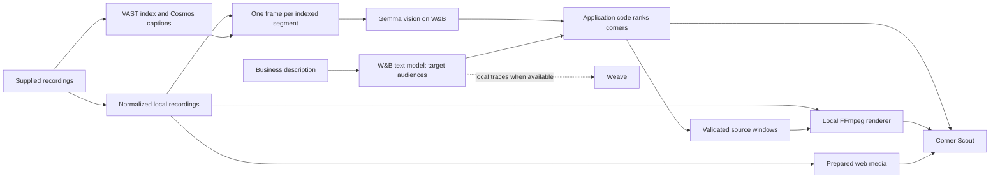

# Highlight Agent

<p align="center">
  <strong>Find your corner. See the evidence.</strong><br>
  Corner Scout turns recorded street footage into a shortlist of locations for your business, with playable evidence behind every recommendation.
</p>

<p align="center">
  <a href="https://corner-scout-rouge.vercel.app"><strong>Try the live demo</strong></a> ·
  <a href="#watch-the-demo">Watch the video</a> ·
  <a href="#try-it-locally">Quick start</a> ·
  <a href="#prepare-footage">Prepare footage</a> ·
  <a href="#under-the-hood">How it works</a> ·
  <a href="#prove-the-result">Validation</a>
</p>

**Corner Scout** is the featured application in Highlight Agent, a toolkit for finding visual moments and rendering evidence reels. Describe a business, compare corners within one city, and inspect the footage behind the ranking. The toolkit also includes caption reports and a conversational highlight editor.

Built for **Real-Time Video Agents Hack**, London · **17 October 2026**.

[](https://corner-scout-rouge.vercel.app)


<a id="watch-the-demo"></a>

## 🎬 See it in action

<p align="center">
  <a href="docs/assets/corner-scout-demo.mp4"></a><br>
  <a href="https://drive.google.com/file/d/1zZgiQSG6cm3ZWqlijK4rIugzymr1lPrq/view?usp=sharing"><strong>Watch the 82-second demo with sound</strong></a> · <a href="docs/assets/corner-scout-demo.mp4">MP4 in this repo</a>
</p>

The video shows real searches from the **original five-camera San Francisco sample**: dog grooming, luxury car detailing, and a kids' toy store with too little evidence for a recommendation. Each search calls the live profile endpoint; the displayed timings are measured. The presenter is AI-generated and the music is synthesized. [Recording and assembly details](#the-demo-uses-the-same-renderer).

**Deep dive: the frame proof.** Click an audience count to see every matching still, inspect all sampled frames, and play the surrounding moment. [Watch the 108-second frame-proof walkthrough](docs/assets/corner-scout-proof-reveal.mp4) or read the [proof controls and recording guide](docs/PROOF_REVEAL.md). The 82-second video above is the main demo.


<a id="features"></a>
<a id="what-we-built"></a>
<a id="corner-scout-where-should-i-open-my"></a>

## ✨ Features

| You want to… | Use… | What you get |
| --- | --- | --- |
| Find a location for a business | **Find my corner** | Rankings of the five sampled SF corners, audience matches, and playable source evidence. |
| Inspect a recommendation | **Evidence viewer** | Sampled frames, audience counts, and the exact source moment behind a match. |
| Make a custom reel (secondary tool) | **Local highlight editor** | Visual briefs, source previews, revision, undo, and downloadable MP4s. Not part of the Corner Scout demo. |

**Saved SF snapshot:** 5 corners · 15 minutes of footage · 180 observations. Each corner has three minutes of footage, sampled once per five-second segment. The checked-in snapshot was exported on 17 October 2026.

**Recommendations need evidence:** the highest-ranked corner must show a core audience in at least **3 sampled frames**. Scores compare audience presence across the sampled corners; frame counts can include the same subject more than once.

**Keep the limits in mind.** Audience labels are vision-model estimates from sampled frames. Counts can include the same person, animal, or vehicle more than once. Recordings cover different dates, times, and durations; they help choose where to investigate next. A lease decision also needs comparable recordings, rent, and competition data. **Human caption and vision accuracy review remains pending.**

<a id="assumptions-and-limitations"></a>

<details>
<summary><strong>Sample assumptions and limitations</strong></summary>

**This is a scouting sample for deciding where to investigate next. Longer, comparable recordings and commercial context are needed for a location decision.**

- **Small, uneven sample.** Each corner has three minutes of footage. Cameras 1–4 were recorded on 1 October at different morning times; Camera 5 was recorded on 6 October at 12:35. Rankings do not control for date or time of day.
- **Estimated categories.** People types and vehicle classes are model judgments from single frames. The same person can appear more than once; an undetected audience may still be present outside the sample.
- **Relative scores.** A match score describes the observed audience mix among these corners. Rent, competition, purchasing intent, unique footfall, and commercial demand are not measured.
- **Finite audience vocabulary.** You can enter a free-text business, but the profile maps onto a fixed category list. Unnamed audiences and helpful-audience choices can vary between model calls.
- **Saved footage, live profiling.** The hosted app uses exported observations and clips, not live camera feeds. It still needs working W&B access for each business request. Full recordings and dataset credentials are not bundled.
- **Validation boundaries.** Automated and browser checks exercise behavior. Human review of category accuracy remains pending, and the synthetic offline fixture establishes local plumbing only.

</details>

The video, screenshots, and tables below describe the **original 15-minute SF sample**, recorded for three minutes per corner. Its 180 frames took 2.7 minutes to tag; saved business searches took about 2–6 seconds. Expanded recordings can produce different rankings.

<details>
<summary><strong>Original SF sample: camera observations and business rankings</strong></summary>

### Who passes each corner

Captions could not answer “who”: across 180 captions, none names a car brand or says “luxury”, one mentions a suit, and none mentions an older person. So a **Gemma 4 vision model on W&B Inference** looked at one frame per five-second segment and estimated what it saw: office workers, students and young adults, families with children, older adults, workers in uniform, premium, mid-range and budget cars, taxis, buses, delivery vehicles, motorcycles and scooters, cyclists, and dogs. The pass took 2.7 minutes and is cached.

| Corner | Landmark | Recorded | Seen most often (frames of 36) |
| --- | --- | --- | --- |
| Camera 1 | Downtown towers | 1 Oct, 09:41 | Premium cars 28 · delivery vehicles 24 · motorcycles & scooters 16 |
| Camera 2 | Fidelity building | 1 Oct, 09:51 | Buses 17 · delivery vehicles 15 · office workers 12 · young adults 10 |
| Camera 3 | Bank of America at Stockton | 1 Oct, 10:04 | Taxis 9 · cyclists 8 · motorcycles & scooters 8 |
| Camera 4 | Transamerica Pyramid in view | 1 Oct, 10:07 | Buses 16 · premium cars 10 · motorcycles & scooters 10 |
| Camera 5 | Condor sign | 6 Oct, 12:35 | Premium cars 20 · cyclists 13 · motorcycles & scooters 7 · dogs 3 |

No tourists and no older adults were detected at any corner.

### Same streets. Different businesses.

| You type… | Core customers | Result in this sample |
| --- | --- | --- |
| 🐕 **Dog grooming salon** | Dogs | **Camera 5**, match 80/100. Dogs in 3 of 36 frames; three other corners have none. |
| 🚗 **Luxury car detailing** | Premium cars | **Camera 1**, 85/100. Premium cars in 28 of 36 frames. |
| 📚 **Student bookshop** | Students & young adults | **Camera 2**, 92/100. Young adults in 10 of 36 frames. |
| 🚲 **Bike repair shop** | Cyclists | **Camera 5**, 83/100. Cyclists in 13 of 36 frames. |
| 🧸 **Kids' toy store** | Families with children | **Not enough evidence.** One stroller in 180 frames. |
| 🎁 **Souvenir shop** | Tourists | **Not enough evidence.** No tourists seen. |

Each result above came out the same in two runs. When a description names an audience (dog, luxury, student, kids, bike…), that audience is always core. Otherwise the text model chooses, and its choice can vary between runs; the chips on every result show what it chose. A recommendation needs at least three core-audience frames at the highest-ranked corner.

### Why frames, not just captions

At Camera 1, **25 of 36 captions mention a bicycle**. Counting caption words would call it a cycling hotspot. The frames show a parked kick scooter and no riders: the vision pass counts **0 cyclists** there. Evidence clips let anyone check.

</details>

<a id="one-business-from-question-to-evidence"></a>

<details>
<summary><strong>Worked example: dog grooming, from question to evidence</strong></summary>

**“Dog grooming salon” puts Camera 5 first because dogs appear in 3 of its 36 sampled frames.**

1. **Describe the business.** The text model proposes its target audiences. Explicit supported audience terms in the description, such as “dog” or “student”, are enforced as core by application rules.
2. **Compare the observations.** Camera 5 has dogs in three frames; Camera 4 has one; the other three cameras have none in this sample.
3. **Inspect the ranking.** In the saved run, Camera 5 scores **80/100**; live runs land within a few points because the helpful audiences the model adds can change. The UI shows the core and helpful audiences and each corner's observed mix.
4. **Inspect the evidence.** Click the count to see all matching sampled frames and the full sampling grid. For dogs, inspect 0:02.5, 0:07.5, and 0:12.5; switch the reviewed detail crop to the full frame, then play the surrounding clip. The same dog can appear in several samples. Local renders also save an `edit_plan.json` with exact source windows.

The score is a relative audience match within this sample. It is not an 80% probability that the business will succeed.

</details>

<a id="a-2-minute-walkthrough"></a>

<details>
<summary><strong>Two-minute walkthrough for the original SF sample</strong></summary>

1. **Click** **Dog grooming salon**. Camera 5 wins; point at “Dogs · core” and “Dogs in 3/36 frames”, then play the evidence clips.
2. **Type** **Luxury car detailing**. Camera 1 wins on premium cars: same footage, different corner.
3. **Click** **Kids' toy store**. “Not enough evidence”: it refuses to guess.
4. **Click** **Bike repair shop**. Camera 1's captions mention a bicycle in 25 of 36 segments, but its frames show a parked kick scooter and zero cyclists: that is why Corner Scout reads frames.

Present the [live app](https://corner-scout-rouge.vercel.app); this is the same walkthrough as the [82-second demo](https://drive.google.com/file/d/1zZgiQSG6cm3ZWqlijK4rIugzymr1lPrq/view?usp=sharing). The hosted app does not create Weave traces; the local pipeline does.

The saved winners apply to the original sample. For the full script, preparation steps, and what to say about limits, see the [demo plan](docs/DEMO_PLAN.md).

</details>

<a id="try-it-locally"></a>
<a id="quick-start"></a>

## 🚀 Quick start

### Run the web demo locally

You need **Node.js 24** and a **W&B Inference API key and text model** for business searches. For a fresh checkout:

```sh
git clone https://github.com/Kakoedlinnoeslovo/highlight-agent-hack.git
cd highlight-agent-hack
```

Run the following commands from the repository root.

1. If you do not already have a `.env`, create it from the template:

   ```sh
   cp .env.example .env
   ```

2. Set these values in the root `.env`:

   ```dotenv
   WANDB_API_KEY=YOUR_WANDB_API_KEY
   WANDB_MODEL=YOUR_AVAILABLE_TEXT_MODEL
   ```

   `WANDB_PROJECT` is optional for the web app. Remove the template's `your-team/highlight-agent` placeholder, or replace it with an accessible `entity/project` if your workspace requires it.

3. Start the app:

   ```sh
   npm --prefix web run dev
   ```

Open **http://localhost:3000** for Corner Scout. The server loads the root `.env` automatically. Restart it after changing provider settings.

The web app uses checked-in observations, sampled images, and evidence clips. No npm installation is needed. Python, VAST access, and FFmpeg are needed when [preparing footage](#prepare-footage).

### Choose the local app you need

| App | Start command | Default address | Before starting |
| --- | --- | --- | --- |
| Web demo | `npm --prefix web run dev` | `http://localhost:3000` | W&B settings for live business searches. |
| Python Corner Scout | `uv run python scripts/corner_scout.py` | `http://127.0.0.1:7861` | Python setup, imported SF footage, and vision tags. |
| Highlight editor | `uv run python app.py` | `http://127.0.0.1:7860` | Python setup and provider settings; import footage from the UI or CLI. |

<a id="prepare-footage"></a>
<a id="from-dataset-to-corner-ranking"></a>

## 🧭 Prepare footage

Use this workflow to analyze recordings, run Python Corner Scout, or refresh the web app's exported data. The existing web demo can be started with the quick start above.

<a id="1-connect-the-providers"></a>

### 1. Set up Python and connect providers

You need **Python 3.11+**, [uv](https://docs.astral.sh/uv/), and **FFmpeg**, with both `ffmpeg` and `ffprobe` on `PATH`.

```sh
uv sync --extra dev
```

Create `.env` as shown in the quick start if it does not exist. The default mode is **live**; configure these values before importing or analyzing footage:

| Setting | What to provide |
| --- | --- |
| `HIGHLIGHT_MODE` | `live` for real provider calls. |
| `VAST_BASE_URL` | Your assigned VAST deployment URL. |
| `VAST_ACCESS_TOKEN` **or** `VAST_USERNAME` + `VAST_PASSWORD` | Credentials supported by that deployment. |
| `WANDB_API_KEY` | Your W&B API key. |
| `WANDB_MODEL` | A text inference model available to your account. |
| `WANDB_PROJECT` | Your Weave destination as `entity/project`; required by the Python live configuration. |

```sh
uv run highlight-agent doctor
uv run highlight-agent doctor --remote
```

`doctor --remote` checks tools, provider connectivity, the deployment schema, and a small inference request. Follow it with an import and actual retrieval/ranking to validate the complete workflow.

W&B can return HTTP 401 for a valid key when `WANDB_PROJECT` names a workspace you cannot access. Use your own accessible W&B workspace; a VAST workshop assignment does not grant W&B team access. Restart running apps after changing `.env`.

`WANDB_INFERENCE_BASE_URL` defaults to `https://api.inference.wandb.ai/v1`. Keep `WANDB_BASE_URL` for the W&B/Weave SDK; pointing it at inference prevents trace initialization. Optional `VAST_UPLOAD_BUCKET`, `VAST_HOST_HEADER`, and `VAST_CAPTION_MODEL` settings are explained in [`.env.example`](.env.example). Confirm caption-model execution from returned model IDs and deployment evidence.

<details>
<summary><strong>Workshop connectivity: Team 37 SSH tunnel</strong></summary>

The Team 37 API is reachable from the lab VM. On a Mac, keep this tunnel running in a separate terminal, replacing `YOUR_LAB_SSH_ALIAS` with your configured lab connection:

```sh
ssh -N -T -o ExitOnForwardFailure=yes \
  -L 127.0.0.1:18737:video-lab-team-37.cosmos.vastdata.com:80 YOUR_LAB_SSH_ALIAS
```

Set `VAST_BASE_URL=http://127.0.0.1:18737` and `VAST_HOST_HEADER=video-lab-team-37.cosmos.vastdata.com` in `.env`. The host header preserves ingress routing. Restart the tunnel after closing its terminal or restarting your Mac.

This deployment serves the UI at `/openapi.json`, so schema inspection may fail even when API login and authenticated configuration reads work. Those checks alone do not establish successful dataset retrieval or rendering.

</details>

<a id="2-import-supplied-sf-streets-footage"></a>

### 2. Import supplied SF Streets footage

Browse the supplied camera streams and import one using the exact source URI returned by the listing:

```sh
uv run highlight-agent datasets

# Replace SOURCE_URI with the original_video URI from the chosen camera entry.
uv run highlight-agent import-dataset SOURCE_URI
```

The importer downloads the exact original objects for up to six contiguous chunks from the selected stream. It uses the shared FFmpeg renderer to prepare each object's indexed window, from zero through `chunk_duration_sec`, as H.264 at 720p and 30 fps, then concatenates those excerpts into a browser-playable recording. The original HEVC files can extend beyond their indexed windows; import excludes those uncaptioned trailing frames. Six indexed 30-second windows provide about **180 seconds**. It reuses the supplied captions without uploading footage or creating a new index. Keep the returned video ID for custom cuts; business reports discover the imported cameras automatically.

<details>
<summary><strong>Import details: source timing, identity, and recovery</strong></summary>

Each remote caption interval is relative to its own chunk. The importer measures the prepared excerpts and records their cumulative starts in the assembled recording; retrieval adds the matching offset to each original interval. The source player, edit plan, and evidence windows use this continuous indexed timeline. Exact original source URIs, original durations and hashes, and prepared excerpt boundaries preserve the mapping back to the supplied dataset.

Reimporting a registered source keeps its video ID. If local media is missing or changed, the importer rebuilds the registered excerpt and checks its saved source hashes, timing, and caption coverage before replacing the media.

</details>

<a id="3-run-corner-scout"></a>

### 3. Tag frames and run Corner Scout

Import each camera you want to compare with `import-dataset`; the saved demo uses five. Corner Scout includes every imported SF Streets recording that has vision tags.

```sh
# Once per imported footage: one frame per indexed segment to the vision model.
uv run python scripts/vision_tags.py

# Optional: landmark headlines for each corner (also builds the city report).
uv run python scripts/city_report.py

# The app: type any business, or click an example.
uv run python scripts/corner_scout.py
# Opens on http://127.0.0.1:7861 by default.

# Or rank one business from the command line (prints JSON, renders reels):
uv run python scripts/corner_scout.py --business 'dog grooming salon'
```

`vision_tags.py` sends each segment's middle frame to `google/gemma-4-31B-it` on W&B Inference and caches estimated counts per category in `data/vision/<video_id>.json` (the saved 180-frame sample took 2.7 minutes). It reuses valid cached observations and retries failed or invalid ones; failed observations stay gaps rather than zero counts.

For each business, the configured W&B text model (`meta-llama/Llama-3.3-70B-Instruct` in the saved runs) returns one or two **core** audiences and up to three **helpful** ones from the fixed category list. Application code scores each corner from the cached counts and writes available evidence reels to `outputs/corner-scout/<time>-<business>/rank-N/` with their `edit_plan.json`. Sparse evidence can produce fewer reels or none.

### 4. Refresh the web snapshot

After importing and tagging footage, export its observations, sampled images, short evidence clips, and shared motion styles:

```sh
uv run python scripts/export_vercel.py
```

Restart `npm --prefix web run dev` to use the refreshed snapshot. The [operating guide](docs/GUIDE.md) covers setup and source timing in more detail.

<a id="host-on-vercel"></a>

## ☁️ Deployment

In Vercel, set **project root** to [web](web/), **framework** to **Other**, and **output directory** to `public`. [`web/vercel.json`](web/vercel.json) supplies the build and function settings; the project uses **Node.js 24**.

Set `WANDB_API_KEY` and `WANDB_MODEL` in Vercel's environment variables. Add an accessible `WANDB_PROJECT` if required by your workspace. `WANDB_INFERENCE_BASE_URL` is optional. Configure Preview separately if you use preview deployments; API keys stay on the server.

With the [Vercel CLI](https://vercel.com/docs/cli) installed, run from `web/`:

```sh
vercel link
vercel env add WANDB_API_KEY production
vercel env add WANDB_MODEL production
vercel --prod
```

The hosted app calls W&B Inference through `/api/profile` for each business search, then scores cached observations in the browser. VAST imports, vision analysis, and FFmpeg rendering happen locally. Hosted searches play prepared evidence and do not create Weave traces.

<a id="under-the-hood"></a>
<a id="how-it-works"></a>

## 🛠️ Architecture



**Models estimate and describe; application code scores and selects.** Each corner's score uses the proportion of sampled frames containing an audience, normalized against the strongest corner for that audience. Core audiences contribute 75% when helpful audiences exist, or the full score otherwise. Ordinary adults and mid-range cars are excluded as general signals. Recommendations must also pass the [three-frame evidence gate](#features).

Python ranking lives in [scripts/corner_scout.py](scripts/corner_scout.py); browser scoring lives in [web/public/scout.js](web/public/scout.js).

Custom briefs use VAST retrieval followed by W&B ranking. The shared selector controls timestamps: it adds two seconds of setup and three seconds of aftermath, clamps windows to the source, skips overlapping street scenes, and fits complete events into the duration budget. A shorter reel is valid when fewer complete matches fit. Caption reports count explicit patterns and ask the model to choose known segment IDs as evidence.

<a id="tools-used"></a>
<a id="models-and-external-services"></a>

### Tools and integration evidence

All four core integrations appear in the build: **VAST, NVIDIA Cosmos, W&B Inference, and W&B Weave**, from three sponsor providers.

| Integration | Contribution | Saved evidence |
| --- | --- | --- |
| **VAST** | Discover/download recordings, read indexed captions, and retrieve moments for custom briefs. | Original SF validation imported six chunks and 36 caption segments with source URIs and timestamp mappings. [Validation](docs/VALIDATION.md#current-sf-streets-workflow) · [Adapter](highlight_agent/vast.py) |
| **NVIDIA Cosmos** | Supply precomputed visual captions for reports and the editor. | Returned rows identify `nvidia/cosmos3-nano-reasoner`. This reuses organizer-generated output; the project did not generate new Cosmos captions or reindex the footage. [Validation](docs/VALIDATION.md#current-sf-streets-workflow) |
| **W&B Inference** | Estimate frame audiences with `google/gemma-4-31B-it`; profile businesses, summarize cameras, and rank editor candidates with a text model. | Original sample: 180 saved Gemma observations. Live text checks used `meta-llama/Llama-3.3-70B-Instruct`. [Vision pass](scripts/vision_tags.py) · [Text client](highlight_agent/inference.py) |
| **W&B Weave** | Trace local provider and application calls when configured. | A real trace was flushed and read back; live people/traffic edits saved trace URLs. [Connection validation](docs/VALIDATION.md#verified-live-connections) · [Tracer](highlight_agent/tracing.py) |

**Supporting tools:** FFmpeg/ffprobe prepare and inspect media; Gradio supplies the Python apps; Python/uv run the pipeline; Node.js/Vercel serve the web app. The Python stack uses the OpenAI-compatible SDK, HTTPX, Pydantic, and python-dotenv. Pytest, Ruff, and Playwright support validation and browser capture. See [Python dependencies](pyproject.toml) and the [web package](web/package.json).

Saved execution artifacts remain local in `outputs/validation/` (`live-connection-check.json`, `sf-import.json`, `sf-people.json`, and `sf-traffic.json`) and `data/vision/*.json`. They establish tool use; [validation notes](docs/VALIDATION.md) summarize the results and remaining checks.

<a id="inputs-outputs-and-evidence"></a>

<details>
<summary><strong>Inputs, outputs, and source mapping</strong></summary>

**Input:** supplied SF Streets camera excerpts, up to six contiguous chunks per recording, and their existing VAST captions. Preset reports use caption signals; the editor accepts a custom brief and a duration of at most 30 seconds.

**Local renderer output:** a **1280×720, 30 fps, H.264/AAC MP4** with `yuv420p` and `+faststart`. Sources without audio receive silence. The hosted app plays prepared clips around the sampled frames. It does not render a new compilation. Each new local highlight writes:

```text
outputs/<edit_id>/
├── reel.mp4        # Playable compilation
├── edit_plan.json  # Ordered source windows and duration budget
├── result.json     # Selected moments, reasons, timings, warnings, trace link
└── evidence.json   # Search queries, retrieved candidates, reported caption model
```

All edit window timestamps are seconds relative to the assembled local recording. Each `SourceChunk` retains its exact remote `original_video` URI, original `source_duration` and `source_sha256`, plus the prepared excerpt's measured `duration` and cumulative `start_seconds`. Remote segment intervals are validated within the indexed chunk window before being shifted onto the assembled timeline. Revisions write a new reel, plan, and result linked to the previous edit; they reuse the existing selection evidence. Shared Python contracts live in [`highlight_agent/models.py`](highlight_agent/models.py), with `make_highlight(video_id, prompt, max_duration=30)` and `render_edit_plan(plan)` as the main service/rendering interfaces.

Keep `.env`, full source recordings, local manifests, renders, and traces out of Git. `data/` and `outputs/` are ignored; the public demo snapshot and short clips in `web/public/` are intentionally checked in. Preserve related local artifacts together for offline presentation.

</details>

<a id="prove-the-result"></a>
<a id="results-and-validation"></a>

## 🧪 Validation

Run the automated checks from the repository root:

```sh
uv run ruff check .
uv run pytest -q
npm --prefix web test
```

Python checks need the [development setup](#1-connect-the-providers). Tests cover provider contracts, selection, source integrity, persistence, revision/undo, malformed model output, CLI failures, human evaluation, and real FFmpeg exports. Web tests cover the hosted workflows. [Validation notes](docs/VALIDATION.md) distinguish automated checks, saved-run playback, and live-provider evidence.

**Status: pending human review.** Automated checks do not establish caption accuracy, vision accuracy, unique customer counts, or commercial demand. Inspect the named source footage before reporting reviewed agreement counts.

<details>
<summary><strong>Manual evaluation: vision frames, captions, and source alignment</strong></summary>

| Check | Evidence and status |
| --- | --- |
| Snapshot coverage | [Exported JSON](web/public/corners.json): five corners, 36 observations each, with source references |
| Python behavior | Tests cover provider contracts, interval selection, source integrity, persistence, revision/undo, evaluation gates, and real FFmpeg exports |
| Hosted behavior | Node tests cover profile validation, provider failures, deterministic scoring, sparse-evidence refusal, and clip references |
| Recorded live checks | [Validation notes](docs/VALIDATION.md) document actual imports, renders, browser checks, and timings separately from mocked tests |
| Human quality review | **Pending:** spot-check the 13 vision estimates behind the demo (3 dog, 5 premium-car, 5 young-adult frames) before claiming measured accuracy. The highlight editor's six-case caption review is separate. |

For Corner Scout, spot-check the vision estimates behind each core audience used in the demo. List the frames where an audience was counted, extract them, and confirm by eye:

```sh
uv run python -c "import json; d=json.load(open('data/vision/VIDEO_ID.json')); print([f['seconds'] for f in d['frames'] if f.get('counts') and f['counts'].get('dog')])"
ffmpeg -loglevel error -ss SECONDS -i data/media/VIDEO_ID.mp4 -frames:v 1 check.jpg
```

The planned check covers the three dog frames at Camera 5, five premium-car frames at Camera 1, and five young-adult frames at Camera 2. **Status: pending human review.** Report only the reviewed agreement count. The rankings in the tables above come from saved runs on 17 October 2026; rerun them after changing the vision cache or scoring code.

For the [preset business report](#4-preset-business-report-caption-based), inspect `report.json`, check the segment counts against the indexed captions, and watch every evidence reel against its named source. Confirm that business tabs change the ranking, tied corners remain tied, and sparse evidence produces no recommendation. The saved example is from `outputs/business-report/20261017-140003/report.json`; generated reports and footage remain local and are ignored by Git. The counts demonstrate the report's behavior and do not establish caption accuracy or commercial demand.

For the highlight editor's caption quality on SF Streets (separate from Corner Scout), replace the placeholder video ID and illustrative intervals in [`examples/evaluation-sf-streets.json`](examples/evaluation-sf-streets.json) with **two people-focused moments, two traffic-focused moments, and two ordinary street moments** reviewed in your imported recording. The profile is `sf-streets`, with labels `people`, `traffic`, and `ordinary`.

```sh
uv run highlight-agent evaluate examples/evaluation-sf-streets.json
```

Compare the returned captions against the original footage, fill in each case's `caption_correct`, `observed_label`, and `notes`, then rerun. The human-review gate requires:

- All six cases reviewed against available indexed evidence.
- At least five correct captions and both people and traffic examples recognized.

Unreviewed examples cannot pass. Check complete action boundaries, alignment across chunk joins, changed selections for both briefs, no duplicates, missing audio, duration budgets, and clear empty-result/provider errors. Report actual source duration, import/request/render timings, model IDs, source windows, and available trace links from genuine artifacts.

</details>

<a id="additional-workflows"></a>

## 📚 Additional workflows

These workflows share the same source references and renderer. Expand the one you need, or use the [demo plan](docs/DEMO_PLAN.md) and [evidence viewer guide](docs/PROOF_REVEAL.md). The [operating guide](docs/GUIDE.md) remains available as a standalone reference.

<a id="4-preset-business-report-caption-based"></a>

<details>
<summary><strong>Preset business reports from captions</strong></summary>

Before the vision pass, the first version compared corners for four preset businesses using the supplied Cosmos captions alone. With SF Streets footage imported, it produces a shareable browser page:

```sh
uv run python scripts/business_report.py

# Serve the generated reports and videos locally.
uv run python -m http.server 8765 --bind 127.0.0.1 --directory outputs
```

The command prints `outputs/business-report/RUN/index.html`. Open **`http://localhost:8765/business-report/RUN/index.html#bike-shop`**, replacing `RUN` with the generated folder name. The saved run recorded **28.1 seconds** for all four comparisons and their evidence reels, using footage already imported and indexed.


| You want to open… | The report looks for… | Result in this sample |
| --- | --- | --- |
| 🚲 **Bike shop** | Captions describing people riding bicycles | Camera 3 leads: **11 / 36** matching segments. |
| ☕ **Café** | Groups of pedestrians | Camera 1 leads: **17 / 36**. |
| 🚌 **Transit kiosk** | Buses | Cameras 2 and 4 tie: **15 / 36** each. |
| 🐕 **Dog shop** | Dogs in the captions | **Not enough evidence to recommend a corner.** The best has only **2 / 36**. |

**The parked-bike trap.** A search for any mention of a bicycle would put Camera 1 first; most of those captions describe something parked by a bin. The report narrows the signal to cyclist or riding language:

| Corner | Segments mentioning any bicycle | Segments matching the riding signal |
| --- | ---: | ---: |
| **Camera 3** | 13 / 36 | **11 / 36** |
| **Camera 5** | 11 / 36 | **9 / 36** |
| **Camera 1** | **25 / 36** | 1 / 36 |

Each number counts five-second caption segments, so the same cyclist may appear in more than one segment. The vision pass later identified Camera 1's parked object as a kick scooter, which is why Corner Scout counts zero cyclists there.

The report writes:

```text
outputs/business-report/RUN/
├── index.html                 # Business tabs, rankings, evidence players
├── report.json                # Counts, source references, timing, trace link
└── bike-shop/rank-1/
    ├── reel.mp4               # Evidence reel (20-second budget by default)
    ├── edit_plan.json         # Exact source windows
    └── clip-*.jpg             # Source stills and filmstrips
```

To choose a destination or reuse headlines from a particular city report:

```sh
uv run python scripts/business_report.py \
  --city-report outputs/city-report/RUN/report.json \
  --duration 20 --output-dir outputs/business-report/my-demo
```

</details>

<a id="city-report"></a>

<details>
<summary><strong>City reports and landmark summaries</strong></summary>

Generate landmark headlines, caption summaries, activity tables computed by code, a reel per imported camera, and a best-moment-from-every-camera reel:

```sh
uv run python scripts/city_report.py
```

The command writes `outputs/city-report/RUN/index.html`. The original SF sample's saved run took about 40 seconds; other collection sizes and provider calls can take longer.

</details>

<a id="5-direct-your-own-cut"></a>

<details>
<summary><strong>Direct your own cut: editor, revision, and undo</strong></summary>

After [Python/provider setup](#1-connect-the-providers), launch the Gradio editor:

```sh
uv run python app.py
```

Open **http://127.0.0.1:7860**. Use **Browse SF Streets** and **Use dataset video** to import footage, or import from the CLI.

For a custom visual brief, use the Gradio editor or CLI:

```sh
uv run highlight-agent make VIDEO_ID --prompt 'Show me pedestrians and cyclists.' --duration 30
uv run highlight-agent make VIDEO_ID --prompt 'Show me buses and street traffic.' --duration 30

# Use the edit id returned by make, then the new id returned by revise.
uv run highlight-agent revise EDIT_ID \
  --instruction 'Remove clip two and put the highest-ranked moment first.'
uv run highlight-agent undo REVISED_EDIT_ID
```

The same workflow is available in the UI: source playback, brief cards, progress, a changing timeline, evidence previews, revision, undo, and downloads. Revisions preserve the selected source windows and keep the preceding edit available for undo.

</details>

<a id="synthetic-offline-fixture"></a>

<details>
<summary><strong>Synthetic offline fixture: run without credentials</strong></summary>

To exercise local plumbing without credentials:

```sh
HIGHLIGHT_MODE=offline_sample uv run highlight-agent doctor
HIGHLIGHT_MODE=offline_sample uv run highlight-agent sample
HIGHLIGHT_MODE=offline_sample uv run python app.py
```

The offline sample uses generated color panels and manually labeled captions. Its legacy Pro/Roast fixtures exercise selection, persistence, and real FFmpeg rendering; they provide no SF Streets or sponsor-execution evidence. The legacy evaluation template is [`examples/evaluation.json`](examples/evaluation.json). Live failures never silently switch to this sample.

</details>

<a id="the-demo-uses-the-same-renderer"></a>

<details>
<summary><strong>Demo production: capture and assemble with the shared renderer</strong></summary>

The [demo video](#watch-the-demo) was recorded from the real web app and assembled with the renderer that makes the highlights:

```sh
npm --prefix web run dev                 # Run in a separate terminal; keep it open.
uv run python scripts/record_demo.py      # real searches → data/rehearsal.mp4 + measured beats
uv run highlight-agent demo data/rehearsal-plan.json --output-dir outputs/demo
```

`record_demo.py` drives the app in headless Chromium and captures every painted frame. Each search calls the live `/api/profile` endpoint, so on-screen timings are real. Captions, the pointer, and title cards are in-browser overlays, because the minimal FFmpeg build has no `drawtext`. The script writes measured beats to `data/rehearsal.json` and the fresh assembly manifest to `data/rehearsal-plan.json`. [`examples/demo-plan.json`](examples/demo-plan.json) retains the historical take's measured windows. This capture workflow needs the Python development dependencies and Chromium. Pass `--chromium PATH` if Playwright's bundled browser is missing.

For the published cut, the presenter used a **Nano Banana Pro portrait** and **Veo 3.1 voice and lip-sync**. She was composited into four 8-second slots on the rehearsal. Her lines plus a synthesized, ducked music bed went in as `narration_path`, so `highlight-agent demo` mixed and assembled the final MP4. Paths resolve relative to the manifest. The three-minute final is presented live from the hosted app; see the [demo plan](docs/DEMO_PLAN.md#three-minute-final-additions).

Lead with the [Corner Scout walkthrough](#a-2-minute-walkthrough); the [demo plan](docs/DEMO_PLAN.md) has the full script. The [recording guide](demo-video-toolchain-setup.md) covers capture and assembly; the highlight editor's revise and undo commands are in [Direct your own cut](#5-direct-your-own-cut) and are not part of the demo. Use fresh requests when measured latency fits the slot; label saved runs and disclose shortened waits. Claim that the demo was assembled with the tool only after rendering the real rehearsal this way.

</details>

<a id="hackathon-handoff"></a>

<details>
<summary><strong>Hackathon handoff and submission checklist</strong></summary>

The [event requirements captured in the build plan](HACK_PLAN.md#requirements-and-success-criteria) cover idea, intuitive design, technical quality, reproducibility, documented inputs/outputs and evaluation, and effective use of at least three sponsor tools. The [tools used](#tools-used) section records each integration's contribution and the saved evidence behind it.

Before submitting by **4:30 PM BST on 17 October 2026**:

- Include every team member's name and contact email in the submission.
- Provide an accessible repository, a shareable demo video, and a build/tool description.
- Confirm recording requirements in the submission form and verify the video link without your login.
- Keep the first-round presentation to **two minutes**; prepare a **three-minute** top-five final for **6 PM BST**.

For implementation decisions and milestones, see the [build plan](HACK_PLAN.md).

</details>

<a id="repository-layout"></a>

<details>
<summary><strong>Repository layout and local artifacts</strong></summary>

| Path | Purpose |
| --- | --- |
| [`web/`](web/) | Node API, static UI, scoring tests, exported observations, sampled images, evidence clips, and Vercel config |
| [`scripts/corner_scout.py`](scripts/corner_scout.py) | Local business profiling, ranking, evidence rendering, and Gradio UI |
| [`scripts/vision_tags.py`](scripts/vision_tags.py) | Cached vision observations from sampled source frames |
| [`scripts/export_vercel.py`](scripts/export_vercel.py) | Export observations, sampled images, and short clips for the hosted app |
| [`scripts/business_report.py`](scripts/business_report.py), [`scripts/city_report.py`](scripts/city_report.py) | Caption-based comparison reports and camera summaries |
| [`highlight_agent/`](highlight_agent/) | Shared CLI, provider adapters, contracts, storage, selection, evaluation, and rendering |
| [`app.py`](app.py) | Conversational highlight editor on port 7860; Corner Scout uses port 7861 |
| [`tests/`](tests/), [`examples/`](examples/) | Python checks and editable evaluation/demo templates |
| [`docs/GUIDE.md`](docs/GUIDE.md) | Full setup, deployment, reports, outputs, evaluation, and rehearsal instructions |

Local `data/` and `outputs/` are ignored. Keep full footage, manifests, renders, traces, and `.env` out of Git; the exported snapshot, sampled images, and short clips under `web/public/` are intentionally checked in.

</details>

<a id="team"></a>

## 👥 Team

<p align="center">
  
  <br>
  <sub>Building Corner Scout at the Real-Time Video Agents Hack, London, 17 October 2026.</sub>
</p>

| Name | Contact |
| --- | --- |
| Igor Pejic | [igorpejicw@gmail.com](mailto:igorpejicw@gmail.com) |
| Lalit KM | [lalit.hilmarsh@gmail.com](mailto:lalit.hilmarsh@gmail.com) |
| Roman Degtiarev | [ro.degtiarev@gmail.com](mailto:ro.degtiarev@gmail.com) |

<a id="help-and-contributions"></a>

## 🤝 Help and contributions

**Report a reproducible problem or propose a focused change through the repository.**

Open an [issue](https://github.com/Kakoedlinnoeslovo/highlight-agent-hack/issues) with the workflow, command, expected behavior, and sanitized error output. Include source windows and model IDs when relevant. For a pull request, explain the behavior change and run the Python or Node checks for the affected workflow. Never include credentials or private source footage.

Maintained by [Kakoedlinnoeslovo](https://github.com/Kakoedlinnoeslovo). For project context, see the [build plan](HACK_PLAN.md), [validation record](docs/VALIDATION.md), [Corner Scout demo plan](docs/DEMO_PLAN.md), and [recording guide](demo-video-toolchain-setup.md).
