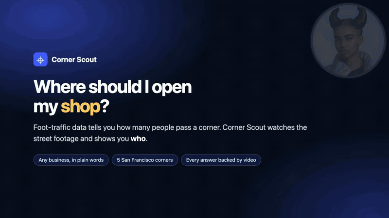
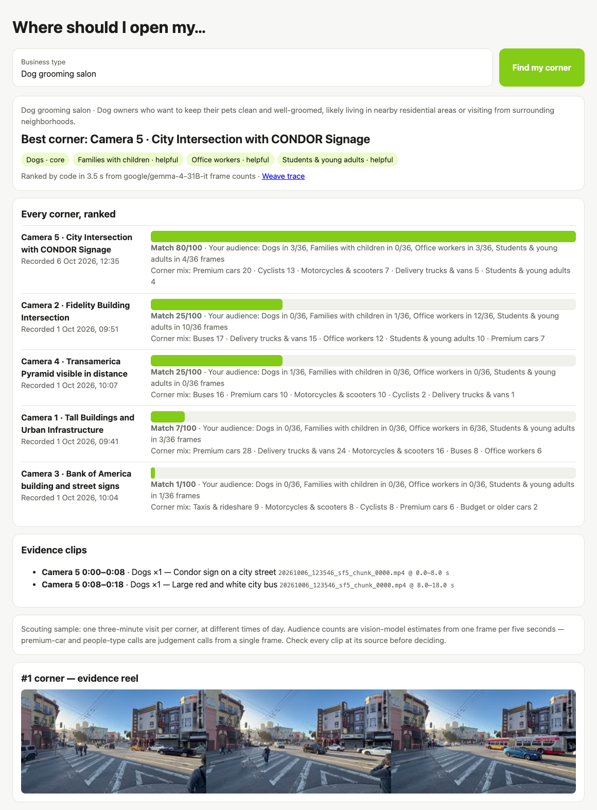
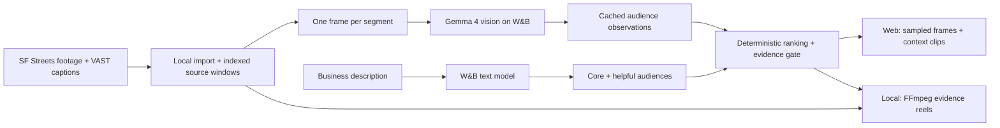
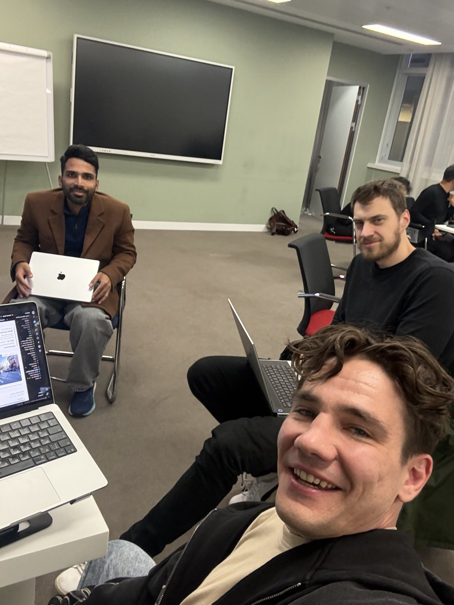

<div align="center">

# Corner Scout

**Find your corner. See the evidence.**

Tell us what business you're opening. See which street corners have its audience,<br>
with ranked results and playable source clips.

*Real-Time Video Agents Hack · London · 17 October 2026*


[**Try the live demo**](https://corner-scout-rouge.vercel.app) · [**Quick start**](#quick-start) · [**How it works**](#how-it-works) · [**Results**](#results-and-validation) · [**Operating guide**](docs/GUIDE.md)

</div>

<p align="center">
  <a href="docs/assets/corner-scout-demo.mp4"></a>
  <br>
  <a href="https://drive.google.com/file/d/1zZgiQSG6cm3ZWqlijK4rIugzymr1lPrq/view?usp=sharing"><strong>▶ Watch the 82-second demo with sound</strong></a> · <a href="docs/assets/corner-scout-demo.mp4">MP4 in this repo</a>
  <br>
  <sub>Real searches in the web app, recorded in one take before the UI redesign: dog grooming salon, luxury car detailing, a kids' toy store it refuses to recommend, and why frames beat caption words. The presenter is AI-generated (Nano Banana Pro portrait, voiced and lip-synced with Veo 3.1) and the music was synthesized for this video. <a href="docs/GUIDE.md#the-demo-uses-the-same-renderer">How it was made</a>.</sub>
</p>

**Inspect the frame proof:** click an audience count to see every matching still, inspect all sampled frames, and play the surrounding moment. [Watch the 108-second frame-proof walkthrough](docs/assets/corner-scout-proof-reveal.mp4) or read the [proof controls and recording guide](docs/PROOF_REVEAL.md).

> **In 30 seconds:** Opening a shop is a bet on a corner. Corner Scout samples street footage, estimates which audiences appear, and matches them to a business description. A vision model reads the frames; a text model identifies core and helpful audiences; application code ranks the corners. Every recommendation links to video evidence. When the best corner has fewer than three frames showing a core audience, it says **“Not enough evidence.”**

| **5 corners** | **15 minutes** | **180 observations** | **3-frame minimum** |
|:---:|:---:|:---:|:---:|
| San Francisco camera streams | Three minutes per corner | One frame per five-second segment | Required for a recommendation |

These describe the checked-in demo snapshot, exported on 17 October 2026. Counts are model estimates from sampled frames; recordings come from different dates and times. [Read the limits](#assumptions-and-limitations) before interpreting a ranking.

<details>
<summary><strong>See a saved Corner Scout result</strong></summary>

<p align="center">
  <a href="https://corner-scout-rouge.vercel.app">
    
  </a>
  <br>
  <sub>A saved run of the local app. The hosted demo plays exported clips; the local app also renders stitched evidence reels.</sub>
</p>

</details>

**Explore:** [What we built](#what-we-built) · [Worked example](#one-business-from-question-to-evidence) · [Architecture](#how-it-works) · [Validation](#results-and-validation) · [Setup](#quick-start) · [Services](#models-and-external-services) · [Limits](#assumptions-and-limitations) · [Repository](#repository-layout) · [Team](#team) · [Help and contributions](#help-and-contributions)

## What we built

**A business-location scout that answers “Where should I open my…?” with observations you can inspect.**

Type *dog grooming salon*, *luxury car detailing*, or *student bookshop*. Corner Scout identifies the relevant audiences, compares the same five corners, and shows its evidence. It uses the shared **Highlight Agent** engine, which also supports caption-based reports and a conversational video editor.

| Experience | What you get | Start here |
| --- | --- | --- |
| **Hosted Corner Scout** | A fresh audience profile, rankings over saved observations, and sampled-frame proof with playable context | [Live demo](https://corner-scout-rouge.vercel.app) or [web quick start](#quick-start) |
| **Local Corner Scout** | Rankings over imported cameras, stitched evidence reels, and Weave traces when available | [Local setup](docs/GUIDE.md#try-it-locally) |
| **Preset and city reports** | Shareable HTML reports from the supplied captions, with counts and video evidence | [Report commands](docs/GUIDE.md#4-preset-business-report-caption-based) |
| **Highlight editor** | Custom briefs, source previews, editable cuts, revision, undo, and MP4 downloads | [Editor commands](docs/GUIDE.md#5-direct-your-own-cut) |

### One business, from question to evidence

**“Dog grooming salon” puts Camera 5 first because dogs appear in 3 of its 36 sampled frames.**

1. **Describe the business.** The text model proposes its target audiences. Explicit supported audience terms in the description, such as “dog” or “student”, are enforced as core by application rules.
2. **Compare the observations.** Camera 5 has dogs in three frames; Camera 4 has one; the other three cameras have none in this sample.
3. **Inspect the ranking.** In the saved run, Camera 5 scores **80/100**. The UI shows the core and helpful audiences and each corner's observed mix.
4. **Inspect the evidence.** Click the count to see all matching sampled frames and the full sampling grid. For dogs, inspect 0:02.5, 0:07.5, and 0:12.5; switch the reviewed detail crop to the full frame, then play the surrounding clip. The same dog can appear in several samples. Local renders also save an `edit_plan.json` with exact source windows.

The score is a relative audience match within this sample. It is not an 80% probability that the business will succeed.

### A 2-minute walkthrough

1. Choose **Dog grooming salon**. Click the 3-of-36 count, inspect the three matching stills, and play the surrounding footage.
2. Enter **Luxury car detailing**. Camera 1 leads on premium cars: the same footage answers a different question.
3. Choose **Kids' toy store**. Sparse family observations produce **“Not enough evidence.”**
4. In the local app, open a **Weave trace** when available to inspect the call. The hosted demo does not create traces.

The [demo plan](docs/DEMO_PLAN.md) has the full script, preparation steps, and wording for the limits.

## How it works

**Models estimate what is visible and which audiences matter; application code scores the corners and selects source evidence.**



The import and vision pass run ahead of time. Each hosted request calls `/api/profile` for a fresh audience profile, then the browser ranks the exported observations. VAST access, full source recordings, FFmpeg, and Weave are used by the local workflows; the hosted runtime uses the checked-in snapshot, sampled images, and clips.

<details>
<summary><strong>How scoring, abstention, and source references work</strong></summary>

- **Presence rates:** count frames containing an audience, divide by the corner's sampled-frame count, and normalize against the strongest corner for that audience.
- **Audience weights:** core audiences contribute 75% of the match and helpful audiences 25% when helpful audiences are present. Broad baseline categories, such as ordinary adults and mid-range cars, are excluded.
- **Evidence gate:** recommend only if the highest-ranked corner has a core audience in at least three sampled frames. These are frame appearances, not three distinct customers.
- **Evidence selection:** favor relevant frames and retain their source references. Local rendering validates the source windows, adds context, and fits complete clips into the duration budget.
- **Provenance:** imported chunks retain original URIs, hashes, measured excerpt durations, and offsets onto the assembled local timeline.

Python ranking lives in [`scripts/corner_scout.py`](scripts/corner_scout.py); browser scoring lives in [`web/public/scout.js`](web/public/scout.js). The [operating guide](docs/GUIDE.md#inputs-outputs-and-evidence) explains output artifacts and timing in detail.

</details>

## Results and validation

**The saved runs choose different corners for different businesses and abstain when the core audience is too sparse.**

| Business | Core audience | Saved result | Observation behind it |
| --- | --- | --- | --- |
| Dog grooming salon | Dogs | **Camera 5 · 80/100** | Dogs in **3/36** frames |
| Luxury car detailing | Premium cars | **Camera 1 · 85/100** | Premium cars in **28/36** frames |
| Student bookshop | Students and young adults | **Camera 2 · 92/100** | Young adults in **10/36** frames |
| Bike repair shop | Cyclists | **Camera 5 · 83/100** | Cyclists in **13/36** frames |
| Kids' toy store | Families with children | **Not enough evidence** | One stroller across 180 sampled frames |
| Souvenir shop | Tourists | **Not enough evidence** | No tourists detected in the sampled frames |

These are saved observations and runs from 17 October 2026, not an independent accuracy benchmark. The original two runs agreed on each result above. Fresh profiles can vary, particularly when a description does not name a supported audience; inspect the audience chips rather than expecting identical scores.

**Why inspect frames as well as captions?** At Camera 1, 25 of 36 captions mention a bicycle. A caption-only search would suggest a cycling hotspot; the vision pass identifies a parked kick scooter and counts zero cyclists. Playable source evidence makes that disagreement visible.

| Check | Evidence and status |
| --- | --- |
| Snapshot coverage | [Exported JSON](web/public/corners.json): five corners, 36 observations each, with source references |
| Python behavior | Tests cover provider contracts, interval selection, source integrity, persistence, revision/undo, evaluation gates, and real FFmpeg exports |
| Hosted behavior | Node tests cover profile validation, provider failures, deterministic scoring, sparse-evidence refusal, and clip references |
| Recorded live checks | [Validation notes](docs/VALIDATION.md) document actual imports, renders, browser checks, and timings separately from mocked tests |
| Human quality review | **Pending:** spot-check the vision estimates and complete the six-case caption review before claiming measured accuracy |

To repeat the checks after [installing the Python development dependencies](docs/GUIDE.md#try-it-locally):

```sh
uv run ruff check .
uv run pytest -q
(cd web && npm test)
```

See the [evaluation procedure](docs/GUIDE.md#prove-the-result) for frame inspection and the human-review gate. Example evaluation files contain illustrative intervals and do not represent passing results.

## Quick start

**Run the web app from the checked-in snapshot with Node.js 24 and a W&B Inference account.** No Python setup or dataset import is needed for this path.

```sh
git clone https://github.com/Kakoedlinnoeslovo/highlight-agent-hack.git
cd highlight-agent-hack

# Preserve an existing local configuration.
if [ ! -f .env ]; then cp .env.example .env; fi
```

Set these values in the root `.env` before starting:

```dotenv
WANDB_API_KEY=your-wandb-api-key
WANDB_MODEL=a-text-model-available-to-your-account
# Replace the copied project placeholder with your entity/project,
# or clear it if your W&B workspace does not require it:
WANDB_PROJECT=
```

```sh
cd web
npm test
npm run dev
```

Open **http://localhost:3000** and try a business. The app has no npm dependencies; the dev command loads `../.env`. Keep the key on the server. W&B calls require valid access and may consume account credits. No results are silently substituted when the provider fails.

| Want to… | Follow this path |
| --- | --- |
| Deploy the web demo | [Vercel setup](docs/GUIDE.md#host-on-vercel): project root `web`, framework **Other**, output `public` |
| Reproduce the vision pass and render reels | [Python + FFmpeg setup](docs/GUIDE.md#try-it-locally), then [connect and import](docs/GUIDE.md#from-dataset-to-corner-ranking) |
| Test local plumbing without API credentials | [Synthetic offline fixture](docs/GUIDE.md#synthetic-offline-fixture), using generated color panels |
| Resolve connection or workspace errors | [Provider settings and troubleshooting](docs/GUIDE.md#1-connect-the-providers) |

## Models and external services

**The hosted app needs W&B Inference; reproducing the full local pipeline also needs the assigned VAST deployment and local media tools.**

| Tool | Role | Where it runs |
| --- | --- | --- |
| **VAST** | Supplies original camera chunks, indexed segment windows, and caption retrieval | Local import and editor |
| **NVIDIA Cosmos** | Supplies the dataset's existing visual captions for reports and custom briefs | Upstream dataset ingestion; this repo reuses its captions |
| **W&B Inference** | `google/gemma-4-31B-it` estimates frame audiences; the configured text model profiles businesses and supports the other workflows | Vision pass locally; text inference locally and through the hosted API |
| **W&B Weave** | Traces provider and application calls when configured | Local workflows |
| **FFmpeg + ffprobe** | Prepare indexed excerpts, extract frames, render reels, and measure media | Local workflows |
| **Gradio / Vercel** | Serve the local Python apps / hosted Node app | Local machine / hosted demo |

The saved text-model runs used `meta-llama/Llama-3.3-70B-Instruct`; choose a model available to your account through `WANDB_MODEL`. See [`.env.example`](.env.example) and the [provider guide](docs/GUIDE.md#1-connect-the-providers) for configuration. Actual artifacts and traces establish which sponsor tools executed in a run.

## Assumptions and limitations

**This is a scouting sample for deciding where to investigate next. Longer, comparable recordings and commercial context are needed for a location decision.**

- **Small, uneven sample.** Each corner has three minutes of footage. Cameras 1–4 were recorded on 1 October at different morning times; Camera 5 was recorded on 6 October at 12:35. Rankings do not control for date or time of day.
- **Estimated categories.** People types and vehicle classes are model judgments from single frames. The same person can appear more than once; an undetected audience may still be present outside the sample.
- **Relative scores.** A match score describes the observed audience mix among these corners. Rent, competition, purchasing intent, unique footfall, and commercial demand are not measured.
- **Finite audience vocabulary.** You can enter a free-text business, but the profile maps onto a fixed category list. Unnamed audiences and helpful-audience choices can vary between model calls.
- **Saved footage, live profiling.** The hosted app uses exported observations and clips, not live camera feeds. It still needs working W&B access for each business request. Full recordings and dataset credentials are not bundled.
- **Validation boundaries.** Automated and browser checks exercise behavior. Human review of category accuracy remains pending, and the synthetic offline fixture establishes local plumbing only.

## Repository layout

| Path | Purpose |
| --- | --- |
| [`web/`](web/) | Node API, static UI, scoring tests, exported observations, sampled images, evidence clips, and Vercel config |
| [`scripts/corner_scout.py`](scripts/corner_scout.py) | Local business profiling, ranking, evidence rendering, and Gradio UI |
| [`scripts/vision_tags.py`](scripts/vision_tags.py) | Cached vision observations from sampled source frames |
| [`scripts/export_vercel.py`](scripts/export_vercel.py) | Export observations, sampled images, and short clips for the hosted app |
| [`scripts/business_report.py`](scripts/business_report.py), [`scripts/city_report.py`](scripts/city_report.py) | Caption-based comparison reports and camera summaries |
| [`highlight_agent/`](highlight_agent/) | Shared CLI, provider adapters, contracts, storage, selection, evaluation, and rendering |
| [`app.py`](app.py) | Conversational highlight editor on port 7860; Corner Scout uses port 7861 |
| [`tests/`](tests/), [`examples/`](examples/) | Python checks and editable evaluation/demo templates |
| [`docs/GUIDE.md`](docs/GUIDE.md) | Full setup, deployment, reports, outputs, evaluation, and rehearsal instructions |

Local `data/` and `outputs/` are ignored. Keep full footage, manifests, renders, traces, and `.env` out of Git; the exported snapshot, sampled images, and short clips under `web/public/` are intentionally checked in.

## Team

<p align="center">
  
  <br>
  <sub>Building Corner Scout at the Real-Time Video Agents Hack, London, 17 October 2026.</sub>
</p>

| Name | Contact |
| --- | --- |
| Igor Pejic | [igorpejicw@gmail.com](mailto:igorpejicw@gmail.com) |
| Lalit KM | [lalit.hilmarsh@gmail.com](mailto:lalit.hilmarsh@gmail.com) |
| Roman Degtiarev | [ro.degtiarev@gmail.com](mailto:ro.degtiarev@gmail.com) |

## Help and contributions

**Report a reproducible problem or propose a focused change through the repository.**

Open an [issue](https://github.com/Kakoedlinnoeslovo/highlight-agent-hack/issues) with the workflow, command, expected behavior, and sanitized error output. Include source windows and model IDs when relevant. For a pull request, explain the behavior change and run the Python or Node checks for the affected workflow. Never include credentials or private source footage.

Maintained by [Kakoedlinnoeslovo](https://github.com/Kakoedlinnoeslovo). For project context, see the [build plan](HACK_PLAN.md), [validation record](docs/VALIDATION.md), [Corner Scout demo plan](docs/DEMO_PLAN.md), [editor demo script](docs/DEMO_SCRIPT.md), and [recording guide](demo-video-toolchain-setup.md).
