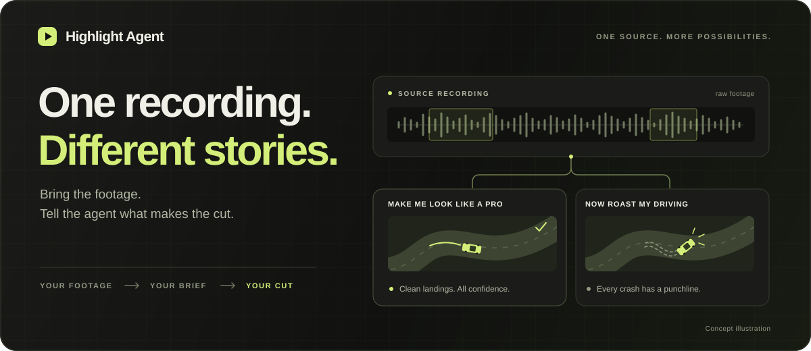
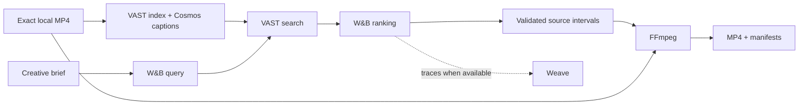

# Highlight Agent

<p align="center">
  
</p>

<p align="center">
  <strong>Your best moments. Or your worst. You direct the cut.</strong><br>
  Turn a gameplay recording and a creative brief into a short compilation, with source evidence for every selection.
</p>

<p align="center">
  <a href="#try-it-locally">Quick start</a> ·
  <a href="#from-recording-to-reel">Live workflow</a> ·
  <a href="#under-the-hood">Architecture</a> ·
  <a href="#prove-the-result">Evaluation</a> ·
  <a href="docs/DEMO_SCRIPT.md">Demo script</a>
</p>

Built for **Real-Time Video Agents Hack**, London · **17 October 2026**.

## Same footage. New brief.

A clean landing and a spectacular crash can happen in the same session. Highlight Agent searches visible actions in indexed video captions, so you can change the story without changing the recording.

| You say | The agent looks for |
| --- | --- |
| **“Make me look like a pro.”** | Clean stunt landings, upright cars, and continued driving. |
| **“Now roast my driving.”** | Crashes, rollovers, and landings that went very wrong. |

- **Direct the edit.** Use either brief card or describe the visual moments you want.
- **See why a moment made the cut.** Inspect selected source windows, captions, reasons, and original video previews.
- **Keep the whole event.** Preserve setup and aftermath, merge overlaps, and fit up to four windows into a budget of at most 30 seconds.
- **Change your mind.** Remove a clip, move the highest-ranked moment first, or undo a revision.
- **Take the result with you.** Download a playable MP4 and keep JSON manifests with the edit and its evidence.

**Current scope:** gameplay compilations exported in **16:9 at 720p**. The Pro/Roast presets target driving footage; other games need briefs that describe their own actions and outcomes. Vertical reframing, subtitles, slow motion, and streaming ingestion are deferred in the [build plan](HACK_PLAN.md).

## Try it locally

You need **Python 3.11+**, [uv](https://docs.astral.sh/uv/), and **FFmpeg**, with both `ffmpeg` and `ffprobe` on `PATH`. Run these commands from the repository root; copy `.env.example` only if you do not already have a `.env`.

```sh
uv sync --extra dev
cp .env.example .env
HIGHLIGHT_MODE=offline_sample uv run highlight-agent doctor
HIGHLIGHT_MODE=offline_sample uv run highlight-agent sample
HIGHLIGHT_MODE=offline_sample uv run python app.py
```

Open the local Gradio URL printed in the terminal, normally **http://127.0.0.1:7860**. Choose the sample source and try both brief cards, inspect the changed timeline, then revise or download a reel.

> **What you are seeing:** offline mode uses generated color panels and manually labeled captions. It exercises the UI, selection, persistence, and real FFmpeg rendering without sponsor credentials. Gameplay understanding and sponsor execution require a live run. Live failures never silently switch to samples.

For sample CLI edits, use the video ID printed by `sample` and prefix each command with `HIGHLIGHT_MODE=offline_sample`.

## From recording to reel

### 1. Connect the providers

The default mode is **live**. Set `HIGHLIGHT_MODE=live` and fill in your local [`.env`](.env.example); the application loads it automatically.

| Setting | What to provide |
| --- | --- |
| `VAST_BASE_URL` | Your assigned VAST deployment URL. |
| `VAST_ACCESS_TOKEN` **or** `VAST_USERNAME` + `VAST_PASSWORD` | Credentials supported by that deployment. |
| `WANDB_API_KEY` | Your W&B API key. |
| `WANDB_MODEL` | An inference model available to your account. |
| `WANDB_PROJECT` | Your Weave destination as `entity/project`. |

```sh
uv run highlight-agent doctor --remote
uv run python app.py
```

`doctor --remote` checks local tools, provider connectivity, the deployment schema, and a small inference request. A successful check still needs to be followed by actual ingestion and retrieval.

W&B can return HTTP 401 when the key is valid but `WANDB_PROJECT` points to a workspace you cannot access. Use an `entity/project` in your own W&B workspace; your VAST workshop team assignment does not grant access to a W&B team. Restart a running application after changing `.env`.

`WANDB_INFERENCE_BASE_URL` overrides the inference endpoint. Keep `WANDB_BASE_URL` for the W&B/Weave SDK; pointing it at inference prevents trace initialization. Optional `VAST_UPLOAD_BUCKET`, `VAST_HOST_HEADER`, and `VAST_CAPTION_MODEL` settings are documented in [`.env.example`](.env.example). A configured caption model is a hint; confirm execution from returned segment model IDs and deployment evidence.

<details>
<summary><strong>Workshop connectivity: Team 37 SSH tunnel</strong></summary>

The Team 37 API is reachable from the lab VM. On a Mac, keep this tunnel running in a separate terminal, replacing `YOUR_LAB_SSH_ALIAS` with your configured lab connection:

```sh
ssh -N -T -o ExitOnForwardFailure=yes \
  -L 127.0.0.1:18737:video-lab-team-37.cosmos.vastdata.com:80 YOUR_LAB_SSH_ALIAS
```

Set `VAST_BASE_URL=http://127.0.0.1:18737` and `VAST_HOST_HEADER=video-lab-team-37.cosmos.vastdata.com` in `.env`. The host header preserves ingress routing. Restart the tunnel after closing its terminal or restarting your Mac.

This deployment serves the UI at `/openapi.json`, so schema inspection may fail even when API login and authenticated configuration reads work. Those checks alone do not establish successful ingestion or retrieval.

</details>

### 2. Register and index your recording

Use permitted local footage, ideally about ten minutes of daylight, third-person driving with clean landings, crashes, and ordinary driving between them. **The local file must exactly match the indexed source**, because every edit uses source-relative timestamps.

```sh
uv run highlight-agent register data/gameplay.mp4 --label 'Driving session'

# Replace VIDEO_ID with the id printed by register.
uv run highlight-agent ingest VIDEO_ID
uv run highlight-agent refresh VIDEO_ID
```

Refresh until `index_status` is `ready`. If the exact recording is already indexed, register it with `--vast-source s3://BUCKET/EXACT-SOURCE.mp4` and refresh instead of uploading again. Upload bucket discovery uses `/config`; set `VAST_UPLOAD_BUCKET` when the deployment does not expose it.

### 3. Change the brief, compare the cuts

```sh
uv run highlight-agent make VIDEO_ID --prompt 'Make me look like a pro.' --duration 30
uv run highlight-agent make VIDEO_ID --prompt 'Now roast my driving.' --duration 30

# Use the edit id returned by make, then the new id returned by revise.
uv run highlight-agent revise EDIT_ID \
  --instruction 'Remove clip two and put the highest-ranked crash first.'
uv run highlight-agent undo REVISED_EDIT_ID
```

The same workflow is available in the UI: source playback, brief cards, progress, a changing timeline, evidence previews, revision, undo, and downloads. Revisions preserve the selected source windows and keep the preceding edit available for undo.

<details>
<summary><strong>Optional: prepare approved YouTube excerpts</strong></summary>

[`scripts/prepare_gameplay_samples.py`](scripts/prepare_gameplay_samples.py) downloads bounded excerpts, validates their media, and uploads them to VAST with private visibility. It requires `uv`, Node.js, FFmpeg, and an organizer-approved **local manifest** at `data/sample_sources/manifest.json`. That ignored manifest and its media are not bundled with a fresh checkout.

```sh
uv run python scripts/prepare_gameplay_samples.py --workers 2
```

The manifest records organizer approval, attribution, source intervals, download state, and upload results. Downloads use `yt-dlp` through `uvx`; uploads run one at a time. Reruns skip confirmed uploads. Use `--download-only` or `--upload-only` to run either stage separately.

Indexed timestamps start at zero in each downloaded excerpt; the manifest preserves its offset in the full stream. An upload confirmation does not mean indexing has finished: refresh the registered video before searching. GTA footage uses the driving caption prompt; other games use prompts describing their visible actions and outcomes.

</details>

## Under the hood



| Tool | Contribution | Evidence to inspect in a live run |
| --- | --- | --- |
| **VAST** | Ingest once and search same-source segments, captions, and timestamps. | Actual upload, index status, and retrieved source records. |
| **NVIDIA Cosmos** | Supply visual captions through hosted ingestion. | Returned segment model IDs, confirmed against the deployment. |
| **W&B Inference** | Translate your brief into a visual query and rank known candidate IDs. | Actual query/ranking calls and selected IDs. |
| **W&B Weave** | Trace provider and application calls when configured. | Trace links returned by the run, when available. |
| **FFmpeg** | Extract, normalize, and concatenate source windows; optionally mix demo narration. | Playable output and measured render timing. |
| **Gradio** | Put source, brief, timeline, evidence, and result in one interface. | The local application. |

**Models choose moments; application code controls timestamps.** The selector adds two seconds of setup and three seconds of aftermath, clamps to the source, merges overlaps, and fits complete events into the budget. The initial edit puts the strongest selected window last. A shorter reel is valid when fewer complete matches fit.

Ranking uses indexed captions. It does not perform a fresh Cosmos rewatch of each candidate. The repository includes provider adapters and local tests; successful sponsor execution, gameplay quality, and live latency must be established from actual runs. Credentials, a hosted index, and source footage are not bundled.

## Inputs, outputs, and evidence

**Input:** an exact local MP4, its matching VAST index in live mode, a creative brief, and a highlight duration of at most 30 seconds.

**Output:** a **1280×720, 30 fps, H.264/AAC MP4** with `yuv420p` and `+faststart`. Sources without audio receive silence. Each new highlight writes:

```text
outputs/<edit_id>/
├── reel.mp4        # Playable compilation
├── edit_plan.json  # Ordered source windows and duration budget
├── result.json     # Selected moments, reasons, timings, warnings, trace link
└── evidence.json   # Search queries, retrieved candidates, reported caption model
```

All window timestamps are seconds relative to the registered source. Revisions write a new reel, plan, and result linked to the previous edit; they reuse the existing selection evidence. Shared Python contracts live in [`highlight_agent/models.py`](highlight_agent/models.py), with `make_highlight(video_id, prompt, max_duration=30)` and `render_edit_plan(plan)` as the main service/rendering interfaces.

Keep `.env`, footage, local manifests, renders, and traces out of Git. `data/` and `outputs/` are ignored. Preserve related artifacts together for offline presentation.

## Prove the result

Run the local checks:

```sh
uv run ruff check .
uv run pytest -q
```

Tests cover provider contracts with mocked HTTP responses, interval selection, source integrity, persistence, revision/undo, malformed model output, CLI failures, human evaluation, and actual FFmpeg exports. The [validation notes](docs/VALIDATION.md) record local browser and rendering checks, with live checks listed separately.

For gameplay quality, replace the placeholder video ID and intervals in [`examples/evaluation.json`](examples/evaluation.json) with **two crashes, two clean landings, and two ordinary-driving negatives** from your indexed source.

```sh
uv run highlight-agent evaluate examples/evaluation.json
```

Compare the returned captions against the original footage, fill in each case's `caption_correct`, `observed_label`, and `notes`, then rerun. The human-review gate requires:

- All six cases reviewed against available indexed evidence.
- At least five correct captions and both event types recognized.
- No crash described as a clean landing.

Unreviewed examples cannot pass. Check complete action boundaries, source alignment, changed selections for both briefs, no duplicates, missing audio, duration budgets, and clear empty-result/provider errors. Report actual source duration, indexing time, request/render timings, model IDs, source windows, and available trace links from genuine artifacts.

## The demo uses the same renderer

Record a genuine 16:9 rehearsal, then assemble the presentation with the renderer that makes the highlights:

```sh
uv run highlight-agent demo examples/demo-plan.json --output-dir outputs/demo
uv run highlight-agent demo examples/demo-plan-extended.json --output-dir outputs/demo-final
```

First replace the illustrative scene windows with measured timestamps from `data/rehearsal.mp4`. Paths resolve relative to the manifest. An optional `narration_path` points to human narration recorded against the assembled cut. These example manifests are templates, rather than prerecorded successful runs; presentation scene selection is manual.

Follow the [two-minute script and three-minute extension](docs/DEMO_SCRIPT.md) and [recording/toolchain guide](demo-video-toolchain-setup.md). Use fresh requests when measured latency fits the slot; label saved runs and disclose shortened waits. Claim that the demo was assembled with the tool only after rendering the real rehearsal this way.

### Hackathon handoff

The [event requirements captured in the build plan](HACK_PLAN.md#requirements-and-success-criteria) cover idea, intuitive design, technical quality, reproducibility, documented inputs/outputs and evaluation, and effective use of at least three sponsor tools. The table above identifies intended contributions; actual traces and artifacts establish which tools ran.

Before submitting by **4:30 PM BST on 17 October 2026**:

- Include every team member's name and contact email in the submission.
- Provide an accessible repository, a shareable demo video, and a build/tool description.
- Confirm recording requirements in the submission form and verify the video link without your login.
- Keep the first-round presentation to **two minutes**; prepare a **three-minute** top-five final for **6 PM BST**.

For implementation decisions, ownership, and milestones, see the [build plan](HACK_PLAN.md).
